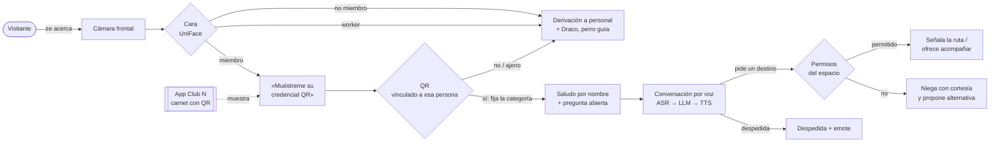

# SENIA · Recepción robótica personalizada

**Entrega final — SabanaHack (Universidad de La Sabana), Reto 2: recepción del Club N.**

**[Ficha técnica de SENIA](FICHA_TECNICA.md)** · descripción comercial, alcance del prototipo y presupuesto estimado.

**SENIA** integra el humanoide **AgiBot X2 Ultra**, la plataforma de guía **D1** y la app móvil Club N
para ofrecer una recepción personalizada. El X2 reconoce al visitante por la cara, le pide la credencial
QR de su membresía, lo saluda según su categoría, conversa por voz, señala la ruta y gesticula mientras
habla. El procesamiento principal corre **a bordo del X2**, sin depender de una API externa. La app
muestra el carnet que el robot lee. La integración de control con D1 sigue pendiente: en esta entrega
el robot lo ofrece o menciona, pero no lo despacha físicamente.

| | |
|---|---|
| **Robot** | Conversación en vivo (micrófono → ASR → LLM → voz), identidad cara + QR, gesto co-verbal y señalamiento, expresiones en la pantalla de la cara — verificados en el X2 real. Emotes propios: verificados en simulación. |
| **App** | Flutter: login por rol (VIP, Regular, Staff), carnet con QR, espacios accesibles, reservas e invitados. |
| **Integración** | Los QR del carnet de la app son credenciales que el robot valida y que fijan la categoría del visitante (comprobado: 4 de 4). |
| **Simulación** | Escenario del Club N en MuJoCo y recorrido de visitante con Meta Quest 3 para validar el flujo de recepción. |
| **Latencia** | De ~27 s en la primera prueba real a **≈ 5–6 s** del fin del habla a la respuesta, con un acuse inmediato en ~2,5 s. |

## El problema

El reto pide que un robot reciba a cada visitante del Club N y lo atienda según su categoría — **socio VIP,
socio, invitado, personal del club y trabajador externo** —, apoyándose en reconocimiento facial
(¿es socio o no?) y confirmando la categoría con información adicional.

## Nuestra solución



- **Identidad en dos pasos**: la cara solo dice si la persona es miembro; **el QR de la app confirma
  la categoría** (y debe pertenecer a esa misma persona). La cara sola nunca basta.
- **Trato por categoría**: VIP como un mayordomo («señor Jorge Castellanos», usted estricto, sin
  exclamaciones), socio con calidez de casa, invitado con orientación, personal tuteado, trabajador
  externo derivado a personal humano.
- **Conversación real a bordo**: Qwen3-4B (llama.cpp en la GPU del Orin) con un contrato JSON validado
  que decide qué decir, qué gesto hacer y la intención; Whisper large-v3-turbo para oír; Supertonic para
  hablar.
- **Cuerpo que acompaña la voz**: gesto co-verbal (103 clips SONIC), 12 emotes propios (saludo,
  despedida, aplauso, corazón…), señalamiento hacia el destino y expresiones en la pantalla de la cara.
- **Seguridad primero**: armado explícito, limitador de velocidad/aceleración, interlock de caída con la
  IMU, watchdog con parada de emergencia y el mando del fabricante siempre por encima.

## Estructura del repositorio

```
├── README.md                ← este documento
├── docs/                    ← documentación de la entrega (empieza aquí)
│   ├── 01-arquitectura.md
│   ├── 02-flujo-de-la-visita.md
│   ├── 03-despliegue-en-el-robot.md
│   ├── 04-app-club-n.md
│   ├── 05-integracion-app-robot.md
│   ├── 06-metricas.md
│   ├── 07-seguridad-y-privacidad.md
│   ├── 08-limitaciones-y-trabajo-futuro.md
│   ├── 09-creditos-y-licencias.md
│   └── 10-simulacion.md
├── robot/                   ← sistema del robot (Python, ROS 2, Docker) — rama sabanahack4.0-deploy
│   ├── src/x2_ultra/hri_runtime/   runtime HRI: FSM, LLM, TTS, ASR, identidad, cara, backend del robot
│   ├── deploy/              scripts de despliegue a bordo (PC → robot) y composes de Docker
│   ├── hriego_v2/           E/S con el robot (audio, cámara) con lista blanca de seguridad
│   ├── Face/                reconocimiento facial (UniFace) y galería del equipo
│   ├── assets/hri/          datos de gestos (HRIEGO), identidades, catálogo de emotes
│   ├── tests/               pruebas automáticas (sin robot)
│   └── docs/                documentación técnica completa del proyecto (simulación, gemelo, robot real)
└── app/                     ← app móvil Club N (Flutter)
```

## Cómo probarlo

| Quiero… | Ve a |
|---|---|
| Entender el sistema en 5 minutos | [docs/01-arquitectura.md](docs/01-arquitectura.md) y [docs/02-flujo-de-la-visita.md](docs/02-flujo-de-la-visita.md) |
| Ejecutar las pruebas sin robot | `cd robot && PYTHONPATH="src:." python -m pytest tests/test_hri_live_robot_actuado.py tests/test_hri_confirm.py -q --noconftest` |
| Hacer una conversación en el PC (texto, sin robot) | [docs/03-despliegue-en-el-robot.md § Probar en el PC](docs/03-despliegue-en-el-robot.md#probar-en-el-pc-sin-robot) |
| Desplegar y arrancar en el X2 real | [docs/03-despliegue-en-el-robot.md](docs/03-despliegue-en-el-robot.md) |
| Correr la app | `cd app && flutter pub get && flutter run` — [docs/04-app-club-n.md](docs/04-app-club-n.md) |
| Ver los números | [docs/06-metricas.md](docs/06-metricas.md) |
| Abrir la simulación (robot, club 3D, gemelo digital) | `git clone --recursive …` y [docs/10-simulacion.md](docs/10-simulacion.md) |

## Resultados en el robot real

- Sesiones armadas en el X2 Ultra real con **0 caídas** y error de seguimiento de brazos ≈ 0,013 rad.
- Identidad real: reconocimiento de los miembros del equipo (similitud 0,47–0,60), lectura de QR y
  confirmación de categoría; rechazo de QR ajenos y derivación de no miembros.
- Latencia: **26,8 s → 11,8–16,3 s → ≈ 5–6 s** del fin del habla al audio de respuesta (medido por el equipo),
  más un acuse inmediato («Permítame un momento.»).
- Detalle y fuentes de cada cifra en [docs/06-metricas.md](docs/06-metricas.md).

## Estado y límites (resumen)

Funciona en el robot real: identidad cara + QR, conversación, gesto co-verbal, señalamiento y
expresiones de la cara. Las optimizaciones de latencia (acuse inmediato, pre-síntesis, una sola llamada al LLM en despedidas,
foco de audio por turno) ya corren en el robot y el equipo notó la mejora; faltan cifras medidas. Los 12
emotes propios están verificados en pruebas y simulación. **No incluido en esta entrega**: que el robot camine acompañando al VIP hasta el ascensor
(la oferta existe en la conversación; la navegación quedó deshabilitada por seguridad y pendiente de
integrar con la tarea de navegación del robot) y el control del perro guía D1 (solo se menciona).
Ver [docs/08-limitaciones-y-trabajo-futuro.md](docs/08-limitaciones-y-trabajo-futuro.md).

## Equipo

Autores de los commits de los repositorios de origen (tal como figuran en git):

| Autor | Repositorio |
|---|---|
| sebastian (`juanulloa2050`) | x2_ultra — sistema del robot |
| Luis Mario Ramirez Muñoz | x2_ultra — sistema del robot |
| Luis Alejandro Gonzalez Guevara | x2_ultra — sistema del robot |
| Lafrul | ClubNApp — app Club N |

Repositorios de origen (historial completo):
[juanulloa2050/x2_ultra](https://github.com/juanulloa2050/x2_ultra) (rama `sabanahack4.0-deploy`, commit `d59a340`) ·
[Lafrul/ClubNApp](https://github.com/Lafrul/ClubNApp) (commit `2752d10`).
