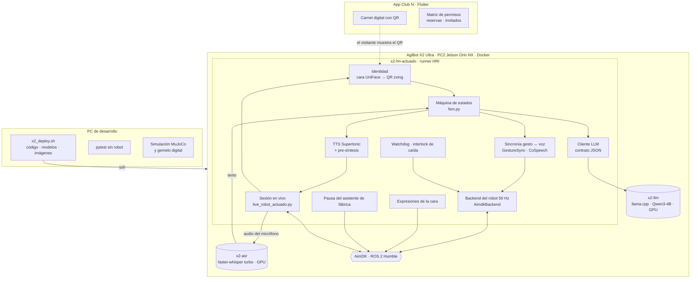

# 01 · Arquitectura

El sistema tiene tres piezas: el **robot** (todo a bordo del AgiBot X2 Ultra), la **app móvil Club N** y
las **herramientas del PC de desarrollo** (despliegue, pruebas, simulación y gemelo digital).

## Vista general

## Componentes del robot

| Componente | Qué hace | Código |
|---|---|---|
| **Runner en vivo** | Bucle semidúplex: escuchar → transcribir → decidir → hablar; arma el robot, coordina todo y lo para con orden | `robot/src/x2_ultra/hri_runtime/live_robot_actuado.py` (sobre `live_robot.py`) |
| **Identidad** | Espera una cara cercana, la reconoce (UniFace, galería del equipo), pide el QR y lo valida contra esa persona | `ActuatedSession.admit_identity`, `hri_runtime/identity.py`, `hri_runtime/confirm/` |
| **Máquina de estados** | LLEGADA → CARA → CONFIRMACIÓN → SALUDO → (destino de rol) → CONVERSACIÓN → OFERTA DE GUÍA → DESPEDIDA | `hri_runtime/fsm.py` |
| **Contrato con el LLM** | Prompt por categoría (tarjetas de persona), esquema JSON estricto `{type, speech, trigger_text, intent, area}`, validador y reparación local | `hri_runtime/contract.py`, `personas.py`, `llm_client.py` |
| **Base de conocimiento** | Espacios del club, horarios, pisos, direcciones y permisos por categoría | `hri_runtime/club_kb.json`, `access.py` |
| **Voz** | Supertonic (ONNX, CPU) a 4 pasos; primera cláusula aparte; pre-síntesis mientras el LLM escribe; acuse inmediato | `hri_runtime/tts.py`, `app.py` |
| **Oído** | Micrófono del robot (6 canales, 16 kHz) → VAD por energía → faster-whisper large-v3-turbo int8 en la GPU, por socket UNIX | `live_robot.py` (`EnergyVad`, `MicPipeline`), `hri_runtime/asr/`, `deploy/compose.asr.yml` |
| **Backend del robot** | Brazos por URS a 50 Hz con limitador de velocidad y aceleración, emotes cinemáticos, señalamiento, cabeza; cintura bloqueada | `hri_runtime/backends/aimdk.py`, `backends/emotes.py` |
| **Gesto co-verbal** | Mientras suena cada frase reproduce un clip SONIC precomputado (103 clips) al 70 % | `CoSpeech` en `live_robot_actuado.py` |
| **Sincronía gesto ↔ voz** | Traduce el reloj de la conversación al del backend y ancla el gesto a la palabra clave de la frase | `GestureSync` en `live_robot_actuado.py` |
| **Seguridad** | Preflight antes de armar, interlock de caída (IMU + odometría de piernas), watchdog con e-stop, parada ordenada | `preflight_robot`, `Watchdog`, `backends/aimdk.py` (`FallInterlock`) |
| **Cara** | Emojis de AimDK sincronizados con la interacción (esperando, escuchando, pensando, feliz…) | `hri_runtime/face.py` |
| **Asistente de fábrica** | Lo pone en `only_voice` durante la sesión (no compite por micrófono ni altavoz) y lo restaura al terminar | `hri_runtime/asistente.py` |
| **E/S segura con ROS** | Audio, cámara y servicios con una lista blanca: lo que no es audio/cámara/cara/asistente se rechaza | `robot/hriego_v2/robot_io.py`, `deploy/hri_audit_ros.py` |

### Contenedores a bordo

| Contenedor | Imagen | Función |
|---|---|---|
| `x2-hri-actuado` | `x2-hri:latest` (ROS 2 Humble + aimdk_msgs, arm64) | runner HRI con actuación |
| `x2-llm` | `x2-ultra/llm:jetson` (llama.cpp CUDA) | Qwen3-4B Q4_K_M, contexto 8192, API OpenAI-compatible en `:8080` |
| `x2-asr` | `dustynv/faster-whisper:r36.4.0-cu128-24.04` | servidor ASR por socket UNIX, sin red |

El robot no tiene internet: imágenes y modelos se llevan desde el PC por el cable
(`robot/deploy/x2_deploy.sh`). Ver [03-despliegue-en-el-robot.md](03-despliegue-en-el-robot.md).

## Decisiones de diseño

- **Todo a bordo.** Se evaluó llevar LLM/ASR/TTS a una GPU en la nube (implementado y apagado,
  `robot/docs/reto-2/INFERENCIA_NUBE.md`): ganaría 1–2 s a cambio de coste mensual, conectividad del
  robot y dependencia de red. Con las optimizaciones a bordo (≈ 5–6 s) no compensó.
- **El LLM no mueve el robot.** Decide qué decir, qué gesto y qué intención; los permisos de acceso, la
  dirección de cada espacio y el movimiento los resuelve código determinista y validado.
- **Contrato JSON estricto + reparación local.** Respuestas validadas (campos, tipos, trato, sin «don»,
  VIP sin exclamaciones); los fallos triviales se reparan sin volver a llamar al LLM.
- **Un nodo ROS por recurso y por sesión.** Crear y destruir nodos por llamada mató el executor
  compartido en el robot real (sin audio): cámara, cara y asistente usan un único cliente persistente.
- **Cargar todo antes de armar.** Cargar el TTS con el robot armado dejó sin servicio al bucle de
  50 Hz (lo detectó el watchdog e hizo e-stop); por eso modelos, LLM y ASR se calientan antes.

## Otras piezas del repositorio del robot

`robot/` es el repositorio completo del proyecto: además del runtime HRI incluye la simulación MuJoCo
del X2 Ultra con manos OmniHand, el gemelo digital con el controlador oficial de AgiBot, el escenario 3D
del Club N (también con Meta Quest 3) y la documentación técnica en `robot/docs/` (índice en
`robot/README.md`). Para la entrega lo relevante es `robot/src/x2_ultra/hri_runtime/` y `robot/deploy/`.
