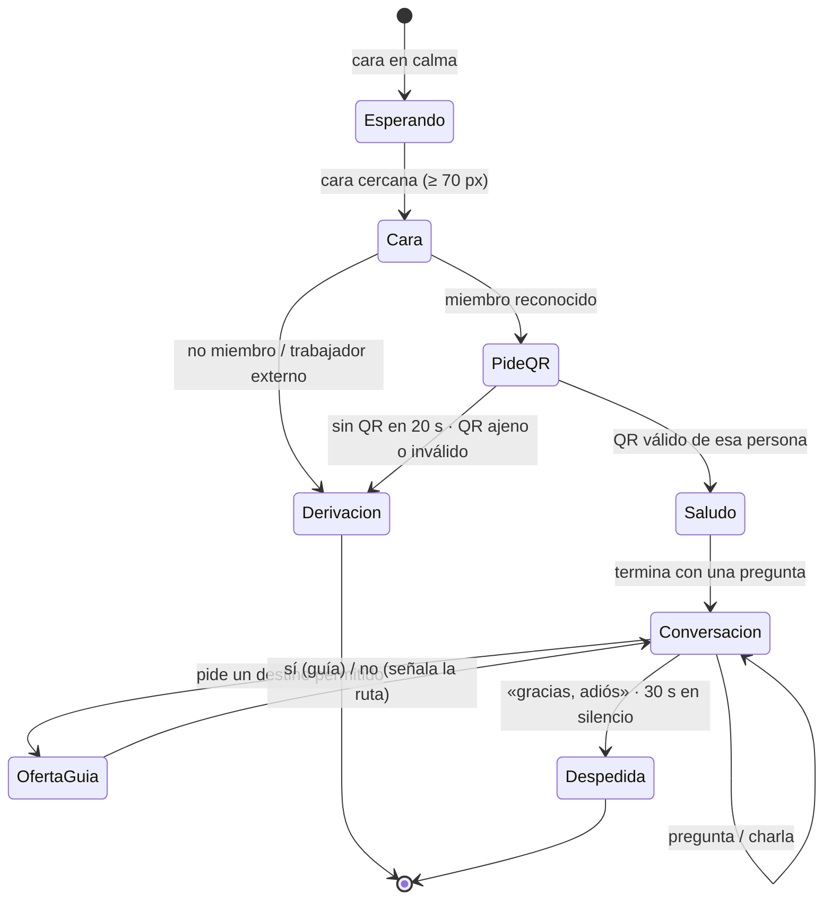

# 02 · Flujo de la visita

Lo que vive un visitante delante del robot, de principio a fin, y cómo cambia según su categoría.

## Máquina de estados

Con `--repetir`, al terminar una visita el robot vuelve a esperar a la siguiente persona.

## Paso a paso

1. **Espera.** Cara en calma; la cámara frontal busca una cara **cercana y de frente** (una persona que
   pasa a 5 m no cuenta). Una cara no reconocida debe verse en dos fotos seguidas antes de actuar.
2. **Cara reconocida → pide el QR.** «Hola, Laura. Para confirmar su membresía, por favor muéstreme su
   credencial QR frente a mi cámara.» Lee la cámara de forma continua hasta 20 s y recuerda acercarlo a
   mitad de tiempo.
3. **QR validado → la categoría la fija el QR**, no la cara, y el QR debe estar vinculado a esa persona.
4. **Saludo** por nombre y con el trato de su categoría, con un emote (saludo con la mano, brazos
   abiertos, choque de manos…) y **siempre una pregunta al final** que invita a hablar.
5. **Conversación por voz.** El robot responde con datos del club (horarios, pisos, servicios), decide
   si el visitante puede entrar al espacio que pide y, si no, se lo dice con cortesía y propone una
   alternativa. Mientras piensa da un acuse breve («Permítame un momento.»).
6. **Guía.** Si el visitante pide ir a un espacio permitido, el robot ofrece acompañarlo; si declina,
   le señala la ruta con el brazo y le indica piso y dirección.
7. **Despedida** con un emote, al decir adiós o tras 30 s sin hablar.

## Según la categoría

| Categoría | Cómo se confirma | Trato | Guía |
|---|---|---|---|
| **Socio VIP** | Cara + QR VIP | Mayordomo: «señor/señorita + nombre», usted estricto, sin exclamaciones, un servicio por turno | Ofrece acompañarle personalmente* |
| **Socio** | Cara + QR socio | Calidez de casa, nombre de pila, «qué gusto verle de nuevo» | Ofrece que le guíe Draco, el perro guía* |
| **Invitado** | Cara + QR invitado | Cordial y orientador, explica dónde están las cosas | Ofrece Draco* |
| **Personal del club** | Cara + QR staff | Tuteo de compañero («¡Dame esos cinco!») | Le indica y señala su destino de trabajo |
| **Trabajador externo** | Cara (sin QR) | Usted, directo | Derivación a personal humano (+ Draco hasta recepción) |
| **No miembro / QR ajeno** | — | Usted, cortés | «Un miembro del personal le atenderá enseguida» (+ Draco) |

\* En esta entrega el robot **no camina** (ver [08](08-limitaciones-y-trabajo-futuro.md)) y el perro D1
no se controla: la oferta y la mención existen en la conversación; el movimiento queda registrado como
no ejecutado.

Los permisos de cada categoría sobre los 15 espacios del club son la misma matriz que muestra la app
([05-integracion-app-robot.md](05-integracion-app-robot.md)).

## Lo que se ve y se oye

| Momento | Voz | Brazos | Cara (pantalla) |
|---|---|---|---|
| Esperando visitante | — | READY | calma |
| Pide el QR | «… muéstreme su credencial QR» | READY | habla / atento |
| Escuchando | — | READY | escuchando |
| Pensando (ASR + LLM) | acuse breve | READY | pensando |
| Hablando | respuesta | gesto co-verbal (clips SONIC) | feliz / según el momento |
| Saludo / despedida | frase de saludo / despedida | emote (saludo, brazos abiertos, choque de manos, corazón…) | muy feliz |
| Indica una ruta | «… queda a mi izquierda, piso 3» | señalamiento hacia el destino | feliz |
| QR rechazado / derivación | frase de derivación | READY | disculpa / triste |

Los 12 emotes propios (`robot/src/x2_ultra/hri_runtime/backends/emotes.py`) sustituyen a las animaciones
de fábrica de AgiBot, que no se pueden distribuir; se verificaron sin autocolisiones en el modelo oficial
del robot (`robot/scripts/check_emotes_mujoco.py`).
