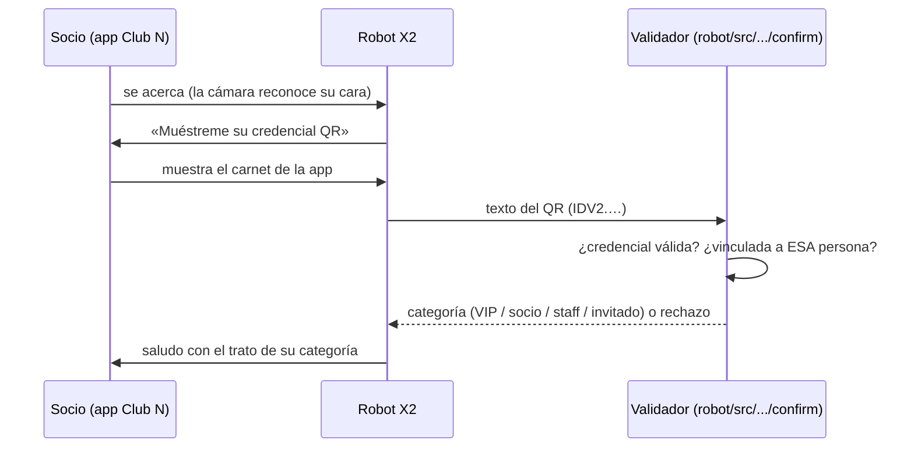

# 05 · Integración app ↔ robot

La app y el robot comparten dos cosas: **la credencial QR** y **la matriz de permisos** del club.

## La credencial QR



Los QR del carnet de la app (`app/assets/qr/`) codifican credenciales **IDV2** que el robot decodifica
(zxing-cpp + OpenCV) y valida con `confirm_identity`. Comprobado sobre los cuatro QR de la app:

| QR de la app | Texto | Titular vinculado | Resultado en el robot |
|---|---|---|---|
| `qr_vip.png` | `IDV2.t6nuic0_…` | Laura / Jorge Castellanos (VIP) | CONFIRMED · VIP |
| `qr_regular.png` | `IDV2.4sWOLajq…` | Sebastian (socio) | CONFIRMED · REGULAR |
| `qr_staff.png` | `IDV2.WCwWUPOA…` | Luis (staff) | CONFIRMED · STAFF |
| `qr_guest.png` | `IDV2.qhHB31v-…` | Mario (invitado) | CONFIRMED · GUEST |

Reproducible con:

```bash
cd robot
PYTHONPATH="src:." python -c "
from x2_ultra.hri_runtime.confirm import confirm_identity, ConfirmConfig
for qr, quien in (('vip','Laura'),('regular','Sebastian'),('staff','Luis'),('guest','Mario')):
    r = confirm_identity(quien, qr_image=f'../app/assets/qr/qr_{qr}.png', config=ConfirmConfig.from_env())
    print(qr, r['status'], r['rank'])"
```

Reglas de seguridad de la credencial:

- El QR solo vale para la persona a la que está vinculado (`robot/src/x2_ultra/hri_runtime/confirm/qr_bindings.default.json`);
  el QR de otra persona se rechaza (`QR_OTHER_PERSON`). Una credencial puede tener varios titulares (el QR VIP
  de la demo vale para Laura y para Jorge Castellanos).
- Los formatos firmados (QR01, QC1 con Ed25519) se verifican con la clave pública si se configura
  (`HRI_QR_PUBLIC_KEY`); los de la demo se aceptan como `DEMO_UNVERIFIED`.

## La matriz de permisos

La app (`app/lib/core/access.dart`) y el robot (`robot/src/x2_ultra/hri_runtime/access.py` +
`club_kb.json`) describen los mismos 15 espacios y qué categoría puede entrar a cada uno: las dos
matrices son **idénticas**, verificadas celda por celda (15 espacios × 6 categorías: VIP, socio,
invitado, staff, logística externa y mantenimiento externo). En la app decide
qué espacios ve y puede reservar el socio; en el robot decide si lo guía a donde pide o le propone una
alternativa.

| Espacio | VIP | Socio | Invitado | Staff |
|---|:---:|:---:|:---:|:---:|
| Recepción y vestíbulos | ✅ | ✅ | ✅ | ✅ |
| Restaurantes y cafeterías | ✅ | ✅ | ✅ | ✅ |
| Bares y La Cava | ✅ | ✅ | ❌ | ❌ |
| Gimnasio · Piscina y spa | ✅ | ✅ | ❌ | ❌ |
| Habitaciones de alojamiento | ✅ | ❌ | ❌ | ✅ |
| Oficinas · Almacenes · Cuartos técnicos | ❌ | ❌ | ❌ | ✅ |

(Tabla completa en `app/README.md`.)

## Siguiente paso natural

Hoy los QR de la app son estáticos por rol. Para producción: que la app genere la credencial firmada
(QR01/QC1) por persona con caducidad, y que el robot la verifique con la clave pública del club — el
validador del robot ya soporta esos formatos.
