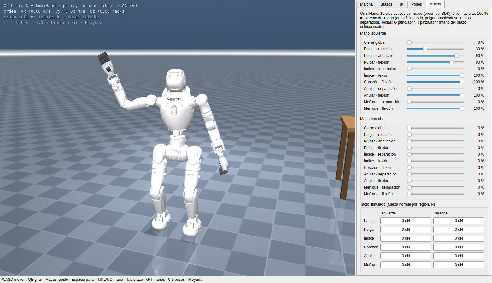

# X2 Ultra · simulación del AgiBot X2 Ultra-N con OmniHand

Simulador MuJoCo del **AgiBot X2 Ultra-N** (cuello de 2 ejes, URDF `X2_URDF-v1.4.0`) con las manos
**OmniHand** articuladas, más la documentación del robot, del SDK **AimDK v1.1.0** y de cómo funciona cada
simulación. Todo funciona **sin gafas VR**: teclado, ratón y paneles (el club del reto 2 admite además unas
Meta Quest 3).

- **Marcha con teclado**: W/A/S/D para moverse y Q/E para girar (mantener pulsado), Mayús para ir más
  rápido. La mueve una policy de RL entrenada en este repo ("brazos libres") que controla piernas y cintura,
  ve los brazos y compensa su peso; los brazos quedan libres para el usuario.
- **Brazos como quieras**: sliders por articulación, cinemática inversa con teclado (I/K J/L U/O mueven la
  mano; Z/X C/V B/N la giran) y 10 poses predefinidas (teclas 0-9).
- **Manos OmniHand en el simulador**: 10 ejes activos + 6 acoplados por mano, 8 poses (puño, pinza,
  agarre…), tacto simulado por región y una mesa con objetos para agarrar.
- **Simulador oficial de AgiBot** (MC real + MuJoCo en Docker) con su propia ventana de teclado WASD/QE.
- **Gemelo digital** (`official_sim/twin.sh`): el MC oficial de AgiBot manejando nuestro Ultra-N + OmniHand con la
  interfaz real del robot: articulaciones, IMU, manos, cámaras, LiDAR y audio/TTS. URS se emula, porque el MC
  publicado no lo trae. La app de control también puede manejarlo por AimDK. Ver
  [docs/08](docs/08-gemelo-digital.md).
- **Escenario del reto 1** (`scripts/run_show.sh`): X2 Ultra-N y X2 EDU sobre una tarima de presentación, delante de
  una pantalla LED que reproduce vídeo, cada uno con su marcha y sus poses. Ver [docs/10](docs/10-reto-1.md).
- **Recepción del reto 2** (`scripts/run_club.sh`): recepción de club al estilo de un hotel (nogal, mármol, latón):
  al entrar, el mostrador con el X2 Ultra-N, que saluda según el tipo de visitante y lo guía por una de tres rutas:
  ascensores (socios, VIP, invitados; le dice el piso), puerta de personal o acceso de servicio (tecla T, con
  subtítulos y voz). En **modo huésped** (M) tú eres, en primera persona, quien entra; el robot te pregunta adónde
  vas, respondes por voz (con **F** puedes terminar la grabación), Qwen responde y solo entonces empiezas a seguirlo. Ver
  [docs/11](docs/11-reto-2.md) y la demo objetivo en [docs/reto-2/demo.md](docs/reto-2/demo.md).
- **Reto 2 con gafas** (`scripts/run_club_vr.sh`): con unas Meta Quest 3, quien las lleva es el visitante que entra
  al club (joysticks), tras hacer el check-in facial en la webcam del PC; su micrófono llega al PC como micrófono
  predeterminado. Ver [docs/16](docs/16-reto-2-vr.md).
- **Robot real** (`scripts/robot_real.sh`): `andar` maneja el X2 físico con la locomoción oficial del MC (WASD/QE,
  7 niveles de velocidad, offroad y cuclillas) y `brazos` mueve cada brazo articulación a articulación en URS con la
  locomoción del MC activa; **los dos funcionan en el robot**. `movimientos` reproduce gestos, los LinkCraft cargados
  y los bailes de fábrica (sin saltos ni voltereta). `check` es de solo lectura. Ver
  [docs/09](docs/09-robot-real.md).



Vídeos: [demo.mp4](docs/media/demo.mp4) (marcha, giros, poses de brazos y manos, empujón;
`python -m x2_ultra.tools.record`) y [demo_mesa.mp4](docs/media/demo_mesa.mp4): girar con Q, ir a la mesa con W y A/D,
llevar la mano a la botella con IK, cerrar la mano, levantarla 14 cm y retroceder con ella
(`python -m x2_ultra.tools.demo_mesa`, que sirve de ejemplo de cómo programar el simulador).

## Arranque rápido

Para probar los retos de Sabana Hack con reconocimiento facial, Qwen local y gestos validados, consulte [la integración HRI](docs/integracion-hri-sabana.md). Los escenarios se abren con `scripts/run_show.sh --hri` (reto 1) y `scripts/run_club.sh --hri` (reto 2). El reto 1 también reproduce el show comercial completo de 19 parlamentos desde el botón **Show completo**, incluso sin `--hri`.

Para **HRIEGO v2** (recepción con webcam, Qwen GPU y voz M1 en CPU), ver
[instalación y ejecución](hriego_v2/README.md):

```bash
./scripts/setup_hriego_v2.sh
./scripts/run_hriego_v2.sh
```

```bash
scripts/setup.sh          # .venv + URDF oficial en third_party/ + MJCF exportado en models/
scripts/run_sim.sh        # abre el simulador (escena con mesa); H en la ventana muestra los controles
scripts/run_show.sh       # escenario del reto 1: dos robots y pantalla de vídeo (--video archivo.mp4)
scripts/run_club.sh       # reto 2: el X2 Ultra-N en la recepción del N Club, con los ascensores al fondo
scripts/run_club_vr.sh    # reto 2 con las Meta Quest 3: tú eres el visitante (--hri: check-in facial)
.venv/bin/python scripts/fetch_linkcraft_dance.py --all-requested  # Tai Chi (1), Chen, Tai Chi (2), Kung Fu
scripts/run_sim.sh --dance assets/motions/tai_chi_1.json
```

Robot real (por cable; guía en [docs/09](docs/09-robot-real.md)):

```bash
scripts/build_aimdk_overlay.sh   # una vez por PC: aimdk_msgs con lo que el SDK no trae (cuclillas, bailes de fábrica)
# cable a develop0 (10.0.1.41); el PC necesita una IP 10.0.1.x: en este PC ya la lleva "G1 robot"
scripts/robot_real.sh check      # solo lectura: ¿se puede armar?
scripts/robot_real.sh andar      # marcha WASD, niveles, offroad, cuclillas
scripts/robot_real.sh brazos     # brazos articulación a articulación (URS)
scripts/robot_real.sh movimientos  # gestos, LinkCraft y bailes de fábrica (--listar: sólo consulta)
```

Opciones: `scripts/run_sim.sh --scene vacia`, `--policy agibot` (policy oficial de AgiBot, que mueve
también los brazos), `--policy-path otra.onnx`. Si el render EGL falla: `MUJOCO_GL=glfw scripts/run_sim.sh`.
Qt ≥ 6.5 necesita `libxcb-cursor0` para abrir la ventana en X11; este PC no la tiene, así que `setup.sh` extrae una
copia local sin sudo (`third_party/syslibs`). La solución de sistema es `sudo apt install libxcb-cursor0`.

`--dance` reproduce las articulaciones y la trayectoria de la base cuadro a cuadro en el modelo MuJoCo (Espacio:
pausa, R: inicio, flechas: saltar 5 s). Es una previsualización cinemática: no usa la policy de marcha ni comprueba
si el controlador físico mantendría el equilibrio. El JSON de LinkCraft se guarda localmente en `assets/motions/`
y no se versiona. Los cuatro archivos son `tai_chi_1.json` (X2 Ultra, 30 s),
`chen_style_tai_chi.json` (X2 Ultra, 48 s), `tai_chi_2.json` (X2 Lite, 46 s) y `kung_fu.json`
(X2 Lite, 30 s). En los dos Lite se dejan neutros los cuatro ejes de muñeca que no trae el archivo.
En el escenario del reto 1 (`scripts/run_show.sh`) los mismos clips se eligen en el panel «Bailes de LinkCraft» y
los baila el robot activo o los dos (tecla L; [docs/10](docs/10-reto-1.md) §3).
Para otra obra pública con un único segmento JSON:
`.venv/bin/python scripts/fetch_linkcraft_dance.py --work-id ID --output assets/motions/otro.json`.

## Controles

| Tecla | Acción |
|---|---|
| W / S | avanzar / retroceder (mantener) |
| A / D | paso lateral izquierda / derecha |
| Q / E | girar a la izquierda / derecha |
| Mayús | más rápido · Espacio: parar en seco |
| I / K · J / L · U / O | mover la mano activa: adelante/atrás · izquierda/derecha · arriba/abajo (IK) |
| Z / X · C / V · B / N | girar la mano: alabeo · cabeceo · guiñada |
| Tab | brazo activo: izquierdo → derecho → ambos en espejo |
| G / T | mano activa: puño ↔ abrir · pinza ↔ abrir |
| 0 – 9 | poses: reposo, saludar, al frente, arriba, cruz, cargar, señalar, dar la mano, jarras, aplaudir |
| Flechas | empujar al robot · R reiniciar · P pausa · F cámara sigue/libre · H ayuda |
| Ratón | izquierdo orbitar · derecho desplazar · rueda zoom · doble clic seguir al robot |

En el **robot real** (`scripts/robot_real.sh andar`, ventana Tk): Intro armar · W/S A/D Q/E mover (mantener) ·
Mayús más rápido · +/− nivel de velocidad · O offroad · F/R agacharse/levantarse · Espacio parar · Esc salir. Antes:
cable (IP 10.0.1.x en el PC), robot en `STAND_DEFAULT` y `scripts/robot_real.sh check` en verde.

Los paneles de la derecha tienen sliders para cada eje de brazo, cabeza y dedo, la IK y las poses, el
estado de la marcha, las velocidades máximas y el tacto de cada mano.

## Documentación

| Documento | Contenido |
|---|---|
| [docs/01-robot-x2-ultra-n.md](docs/01-robot-x2-ultra-n.md) | El robot: variantes, especificaciones, articulaciones, límites, sensores, ordenadores |
| [docs/02-omnihand.md](docs/02-omnihand.md) | Las manos OmniHand: ejes, acoplamientos, tacto, interfaz SDK, poses |
| [docs/03-sdk-aimdk.md](docs/03-sdk-aimdk.md) | AimDK v1.1.0: arquitectura, modos del MC, topics y servicios, ejemplos, precauciones |
| [docs/04-simulacion-mujoco.md](docs/04-simulacion-mujoco.md) | Cómo funciona este simulador: modelo, policy, control, IK, manos |
| [docs/05-simulador-oficial.md](docs/05-simulador-oficial.md) | Simulador oficial de AgiBot (MC + sim_mujoco en Docker) y su teclado |
| [docs/06-locomocion-rl.md](docs/06-locomocion-rl.md) | Entrenamiento de la policy "brazos libres" y comparación con la de AgiBot |
| [docs/07-origen-y-estado.md](docs/07-origen-y-estado.md) | Qué se trajo de g1_teleop, qué se verificó y qué queda pendiente |
| [docs/08-gemelo-digital.md](docs/08-gemelo-digital.md) | Gemelo digital: MC oficial + nuestro MuJoCo como HAL, URS emulado, cámaras, LiDAR, audio |
| [docs/09-robot-real.md](docs/09-robot-real.md) | Robot real: marcha WASD con niveles, offroad y cuclillas; brazos por articulación; gestos, LinkCraft y bailes; protecciones, sesiones en el robot, problemas frecuentes |
| [docs/10-reto-1.md](docs/10-reto-1.md) | Reto 1 (Autoriente): escenario con X2 Ultra-N, X2 EDU y pantalla de vídeo |
| [docs/11-reto-2.md](docs/11-reto-2.md) | Reto 2 (N Club): recepción al estilo hotel, pasillo y ascensores; recepción guiada con voz |
| [docs/12-benchmark-consumo.md](docs/12-benchmark-consumo.md) | Benchmark `x2-bench`: emulación del procesamiento del robot en PC, consumo, latencias y extrapolación al Orin NX |
| [docs/13-registro-benchmark-despliegue.md](docs/13-registro-benchmark-despliegue.md) | Registro del trabajo de benchmark: metodología, corridas válidas (v2, reto2-hri), consumo de CPU y análisis de despliegue |
| [docs/14-plan-despliegue-a-bordo.md](docs/14-plan-despliegue-a-bordo.md) | Plan de desarrollo: todo el sistema a bordo del robot en un contenedor Docker (PC2 Orin NX), sin PC externo |
| [docs/15-guia-pruebas-fisicas.md](docs/15-guia-pruebas-fisicas.md) | Guía de pruebas físicas y despliegue: seguridad, escalera T0-T8, problemas conocidos y datos mínimos por sesión |
| [docs/16-reto-2-vr.md](docs/16-reto-2-vr.md) | Reto 2 con Meta Quest 3: el visitante con gafas, check-in facial y su micrófono en el PC |

## Estructura

```
src/x2_ultra/
  robot/        joints.py (orden SDK, límites, ganancias) · omnihand.py (ejes, mimic, poses, tacto)
  model/        builder.py: MJCF oficial + OmniHand del URDF -> modelo MuJoCo
  control/      locomotion.py (policies ONNX) · arm_ik.py (IK 7 ejes) · poses.py · obs_spec.py
  sim/          engine.py: física en tiempo real + capas de control
  app/          interfaz Qt (vista 3D, paneles, teclado)
  rl/           env.py (entorno vectorizado con mujoco.rollout) · train.py (PPO rsl_rl)
  twin/         gemelo digital: HAL ROS 2 del robot real, URS emulado, cámaras, LiDAR, audio (contenedor)
  real/         robot real por AimDK: walk.py (marcha, offroad, cuclillas) · arms.py (brazos) ·
                motions.py (gestos, LinkCraft, bailes) · check.py ·
                control.py (lógica sin ROS) · link.py (ROS 2) · ui.py
  show/         escenarios de los retos: stage.py (decorados y robots) · venue.py (reto 1: tarima, pantalla) ·
                club.py (reto 2: recepción, pasillo, ascensores) · guide.py (recepción guiada) · textures.py ·
                engine.py · screen.py (vídeo) · dance.py ·
                app.py
  tools/        evaluate.py (pruebas de marcha sin ventana) · record.py (vídeo) · demo_mesa.py (tarea programada)
official_sim/   simulador oficial de AgiBot: sim.sh, Dockerfile, teclado, sonda de marcha; gemelo (twin.sh)
scripts/        setup.sh · run_sim.sh · run_show.sh · run_club.sh · robot_real.sh · build_aimdk_overlay.sh (aimdk_msgs con McBodyPose, SetMcMotion…)
assets/policies policy entrenada + policy oficial de AgiBot (Apache-2.0)
models/         MJCF exportado (escena con mesa y vacía)
docs/           documentación
```

## Estado (2026-10-20)

- **Policy "brazos libres"** (`assets/policies/x2_arms_free_walk.onnx`, v7 it. 2100). En el simulador completo no
  se cae en ninguno de los 13 escenarios de `python -m x2_ultra.tools.evaluate` ni en los 7 difíciles (`--duro`).
  Incluyen las 10 poses de brazos, movimientos aleatorios de brazos en todo su rango (parada, andando y girando) y
  empujones de hasta 200 N.
  - Avanza de −0,29 a 0,88 m/s y va de lado a 0,27 m/s.
  - Con Q/E gira en el sitio a ±0,94 rad/s. Hacia la derecha usa la red reflejada: cada checkpoint giraba bien solo
    hacia un lado ([docs/04](docs/04-simulacion-mujoco.md)).
  - No arranca con órdenes de menos de ~0,25 m/s.

  La policy oficial de AgiBot, en cambio, se cae en 2-5 s si se le sobrescriben los brazos. Cómo se entrenó
  (clonado DAgger de la policy de AgiBot + PPO con currículo de brazos) está en [docs/06](docs/06-locomocion-rl.md)
  y la tabla completa en [docs/07](docs/07-origen-y-estado.md).
- **Simulador oficial**: imagen Docker construida y camino del teclado comprobado (fuente `sdk_` registrada; con W
  el MC empieza a andar). Falta probarlo con el pórtico suelto y las teclas físicas, que requiere usar la ventana
  de MuJoCo.
- **Robot real** (20/10/2026, cinco sesiones): `andar` funciona en el X2 físico: adelante/atrás, lateral y giro
  (desde parado hacen falta ≈0,5 m/s y ≈0,6 rad/s), niveles de velocidad, offroad (`LOCOMOTION_STEP`) y cuclillas
  (`/aima/mc/body_pose`, retirado del AimDK público; `scripts/build_aimdk_overlay.sh`). Nunca cayó ni entró en damping.
  `brazos` también funciona en el robot: los dos brazos por separado, articulación a articulación, en URS, con error de
  seguimiento ≤0,10 rad. `movimientos` ya lista desde el robot 29 gestos, 18 LinkCraft y 8 bailes de fábrica;
  falta reproducirlos en el robot ([docs/09](docs/09-robot-real.md)).
  La policy "brazos libres" es solo para simulación: en el robot anda el MC oficial.

## Licencias de terceros

- URDF y mallas: [AgibotTech/agibot_x2_urdf](https://github.com/AgibotTech/agibot_x2_urdf) (Mulan PSL v2),
  no se copian al repo; `scripts/setup.sh` los enlaza o clona en `third_party/`.
- `assets/policies/agibot_mcrl_policy.onnx` y las ganancias PD: AgiBot `mc-rl` (Apache-2.0).
- Binarios del simulador oficial (mc, sim_mujoco) y AimDK: se descargan de x2-aimdk.agibot.com, no van en git.
