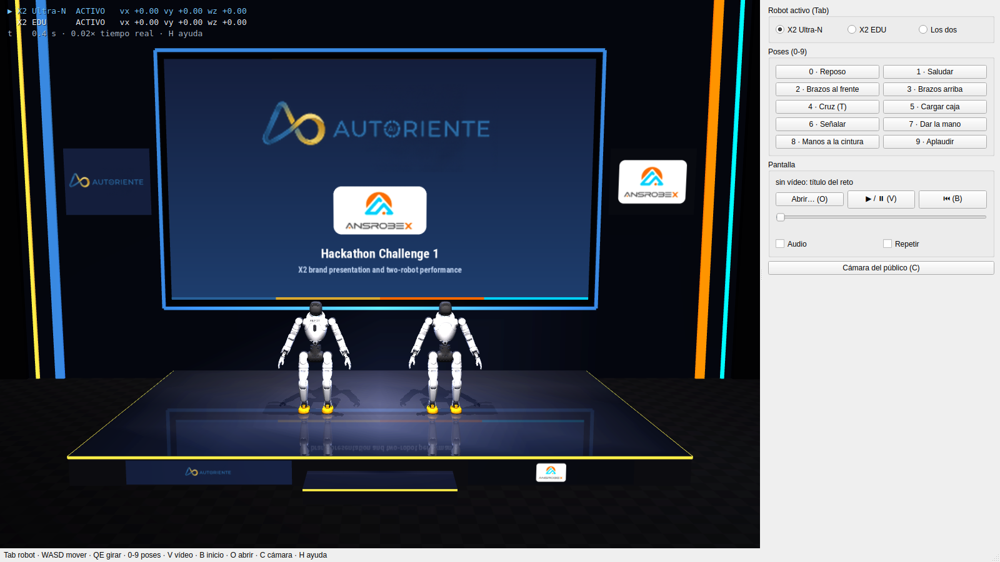
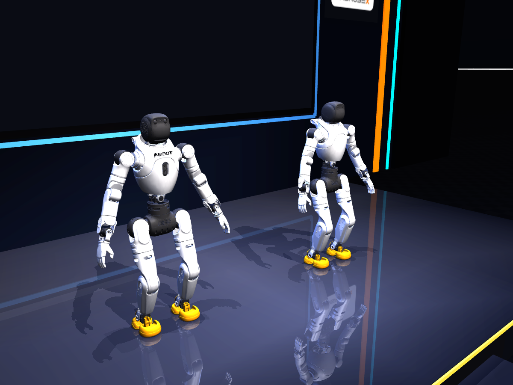

# 10 · Reto 1: escenario con dos robots y pantalla de vídeo

El reto 1 del Hackathon de Autoriente (Universidad de La Sabana, [enunciado](reto-1/reto1.jpeg)) pide un show continuo:

1. **Presentación**: un X2 presenta Autoriente y cuatro modelos de robot (nombre, funciones, rasgos distintivos).
2. **Baile y kung fu**: después, dos robots coreografiados con música y un vídeo de fondo.

Requisitos de presentación: lógica clara, contenido vivo, ritmo ágil y una transición suave de la presentación al
número. Tenemos un **X2 Ultra-N** y un **X2 EDU**, los dos con la muñeca de serie (sin OmniHand). El plan es sacarlo primero en simulación; este
documento cubre el primer paso: el escenario.



## 1. Uso

```bash
scripts/run_show.sh                                   # pantalla con el título del reto
scripts/run_show.sh --video presentacion.mp4          # con un vídeo cargado (V lo reproduce)
scripts/run_show.sh --video presentacion.mp4 --sin-audio
```

| Tecla | Acción |
|---|---|
| Tab | robot activo: Ultra-N → EDU → los dos |
| W / S · A / D · Q / E | marcha del robot activo (mantener); Mayús más rápido; Espacio parar |
| 0 – 9 | poses de brazos del robot activo (las mismas del simulador: saludar, arriba, cruz, aplaudir…) |
| G | puño / abrir (solo si un robot lleva OmniHand; hoy ninguno) |
| V · B · O | vídeo: reproducir/pausa · al principio · abrir otro |
| L | bailar el clip de LinkCraft elegido en el panel (el robot activo o los dos) / parar |
| C | cámara del público · ratón: orbitar, desplazar, zoom |
| R · P · H | reiniciar · pausa · ayuda |

El panel de la derecha tiene lo mismo con botones, más una barra para saltar en el vídeo y las casillas
**Audio** (lo reproduce `ffplay`) y **Repetir**.

## 2. Qué hay en la escena

- **X2 Ultra-N** a la izquierda vista desde el público y **X2 EDU** a la derecha (y = ±0,75 m), los dos mirando al
  público (+x) sobre la **tarima**. Los dos llevan la muñeca de serie, sin OmniHand, como los robots reales hoy: el
  Ultra-N sale de `X2-Ultra.xml` (cuello de 2 ejes, 44,8 kg) y el EDU de `X2-EDU.xml` (sin cuello, 41,2 kg), los dos del
  URDF oficial v1.4.0. Para ponerle las OmniHand al Ultra-N: `StageRobot(..., omnihand=True)` en `show/stage.py`.
- **Aspecto de los robots** (`model/appearance.py`, también en el simulador de un robot): carcasa blanca; pelvis,
  cintura, caderas, hombros, muñecas, tobillos y cabeza en gris oscuro; pies amarillos y el AGIBOT del pecho
  en negro. Los colores por pieza salen del MJCF oficial v1.3.0 (el v1.4.0 lo deja todo blanco). El EDU es igual que
  el Ultra-N; su cabeza viene dentro de la malla del torso y se separa para pintarla.

  

- **Marcas** (`show/brand.py`, logos en `assets/brand/`): colores oficiales sacados de los logos, Autoriente azul
  #286098, oro #D8A830 y azul marino #141E3C; Ansrobex naranja #F86800 y cian #00D0F8.
- **Decorado de venta** (`show/venue.py`): tarima de 3,3 × 6 m y 0,30 m de alto con borde LED oro, escalón y los logos
  de Autoriente (izquierda) y Ansrobex (derecha, en placa blanca) en el frontal; pared azul marino oscuro con la
  **pantalla LED** de 6,4 × 3,6 m (16:9, borde inferior a 1,25 m para que los robots no la tapen) rodeada de un halo
  azul Autoriente; un panel con cada logo a los lados de la pantalla; columnas de luz azul y oro (Autoriente) a la
  izquierda y naranja y cian (Ansrobex) a la derecha; truss delante con focos. Sin vídeo, la pantalla muestra los dos
  logos y el título del reto. La tarima tiene acabado brillante y refleja la pantalla. Ojo al coreografiar: los robots
  empiezan en x = 0, a 1,4 m del borde delantero y a 1,9 m del trasero; si se salen, caen como caería el robot real.
- **Luces**: dos cenitales cálidos, uno por robot, que proyectan sombra; dos contraluces azules desde la pared y un
  relleno frontal suave. El suelo de la sala no refleja: MuJoCo reflejaría a los robots a través de la tarima.
- Textura de la pantalla de 1280 × 720 con material emisivo. Los vídeos se escalan sin deformar (bandas negras si no
  son 16:9).
- Cámara `publico` en el modelo, la misma vista que la tecla C, para grabar el ensayo sin ventana.

Cada robot anda con su propia instancia de la policy "brazos libres" ([06](06-locomocion-rl.md)): la misma red sirve
para el EDU, que la policy ve con la cabeza en la postura por defecto. Medido en el escenario (pruebas en
`tests/test_show.py`): los dos avanzan, giran a ambos lados, van de lado y hacen las poses, también los brazos arriba
andando y girando, sin caerse. La física de los dos va a ~4× tiempo real sin ventana.

## 3. Bailes de LinkCraft

Los clips JSON de LinkCraft de `assets/motions/` (fuera de git; se descargan con
`scripts/fetch_linkcraft_dance.py --all-requested`) se eligen en el panel **Bailes de LinkCraft**: Tai Chi (1),
Tai Chi estilo Chen, Tai Chi (2), Kung Fu y Beat dance. **L** o «Bailar» los arranca en el robot activo o en los dos;
con «Empezar también el vídeo» la pantalla arranca a la vez desde el principio.

- **Cinemático** (`show/dance.py`): en cada paso de física se impone la postura del clip (base y articulaciones); no
  pasa por la policy ni comprueba el equilibrio. Sirve para ver y sincronizar la coreografía, no para saber si el
  robot real la aguanta: en el robot estos movimientos los ejecuta el MC ([09](09-robot-real.md) §4).
- El clip arranca **desde donde está el robot**: el primer cuadro se lleva a su posición y rumbo, y la altura se
  mide desde la tarima. 0,6 s de transición de entrada y de salida; al terminar queda de pie con la postura por
  defecto y vuelve a la marcha. El otro robot sigue con física mientras tanto.
- **Ejes**: `rootPosition` viene con Y vertical; en MuJoCo es (x, −z, y). Con esa conversión los pies apoyados
  deslizan 3-5 mm por cuadro en los cinco clips; con (x, z, y), que refleja el desplazamiento lateral, 18-25 mm.
  `rootRotation` es roll/pitch/yaw sobre los ejes de MuJoCo.
- Ojo con el espacio: algunos clips se desplazan ~1 m hacia delante (Chen, Tai Chi 2) y ±0,7 m de lado; con los dos
  robots bailando el mismo clip a 1,5 m de distancia pueden atravesarse (en la reproducción cinemática no chocan).

## 4. Cómo está hecho

| Archivo | Qué hace |
|---|---|
| `src/x2_ultra/show/stage.py` | Monta el modelo: cada robot con su builder y `MjSpec.attach` bajo un prefijo (`ultra/`, `edu/`) encima de la tarima, y la postura inicial |
| `src/x2_ultra/show/venue.py` | Decorado: tarima, pared, pantalla (malla con coordenadas de textura), logos, columnas LED, truss, focos y cámara del público |
| `src/x2_ultra/show/brand.py` | Logos (recortados y con fondo transparente) y colores de Autoriente y Ansrobex; rótulos e imagen de título |
| `src/x2_ultra/show/engine.py` | `RobotRig` por robot (policy, marcha suavizada, brazos, cabeza, manos, caídas) y `ShowEngine` con la física común en tiempo real |
| `src/x2_ultra/show/screen.py` | `VideoScreen`: decodifica con ffmpeg en un hilo y escribe el fotograma que toca en `model.tex_data`; la vista lo sube con `mjr_uploadTexture` |
| `src/x2_ultra/show/dance.py` | `DanceTrack`: un clip de LinkCraft en un robot del escenario (anclaje, transiciones, vuelta a la marcha) |
| `src/x2_ultra/tools/linkcraft_dance.py` | Lectura de los JSON de LinkCraft (X2 Ultra y X2 Lite) y conversión a ejes de MuJoCo |
| `src/x2_ultra/show/app.py` | Ventana Qt (reutiliza la vista 3D del simulador) |
| `src/x2_ultra/model/builder.py` | `build_edu_spec` (actuadores de posición, ganancias y sensores de pie compartidos con el Ultra-N) y `BuildOptions(omnihand=False)` para el Ultra-N con la muñeca de serie |
| `src/x2_ultra/control/locomotion.py` | Las policies aceptan un prefijo para leer el robot que les toca; las articulaciones que falten se leen en la postura por defecto |

## 5. Límites y siguientes pasos

- **Los bailes son cinemáticos** (sección 3): no dicen si el robot real mantiene el equilibrio. Falta una coreografía
  con línea de tiempo (qué baila cada robot y cuándo) sincronizada con el vídeo y la música.
- El audio va aparte (`ffplay`) y no se resincroniza con la imagen; para ensayar basta.
- **Show completo (19 parlamentos)** reproduce la presentación comercial de las series X, D, C y G en la simulación, con sus WAV y objetivos de brazos a 50 Hz. Solo gesticula quien habla; el otro robot mantiene los brazos en reposo. El segundo papel del material original (X2 Original) lo representa aquí el X2 EDU. Tras el último parlamento, ambos robots hacen **Tai Chi estilo Chen** automáticamente. Al acabar, el Ultra-N da las gracias y los dos saludan con la mano antes de volver a reposo. La transición automática del vídeo sigue pendiente.
