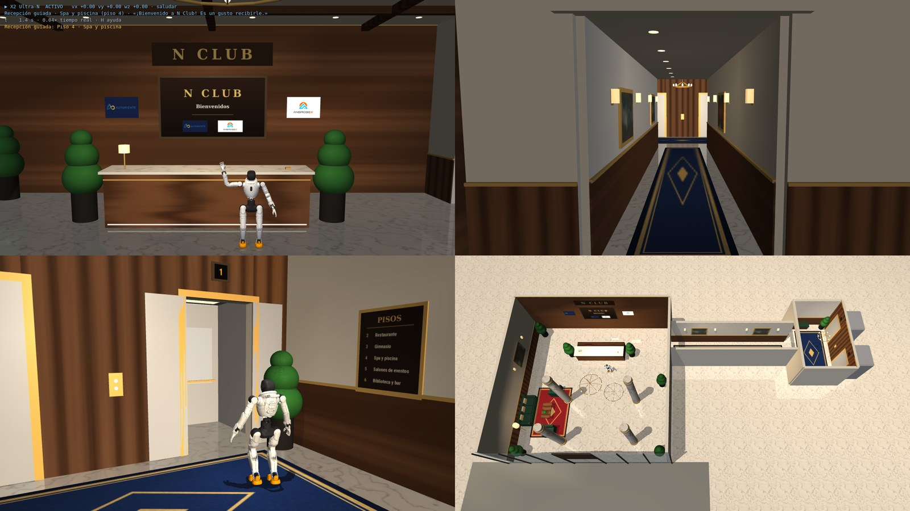

# 11 · Reto 2: recepción del Club N y guía hasta el ascensor

El reto 2 del Hackathon de la Universidad de La Sabana ([enunciado](reto-2/reto2.jpeg)): **Club N** («Club N» en el enunciado), un club
de socios, quiere que un robot reciba en la entrada y guíe a cada visitante. Hay cinco categorías (socios VIP, socios,
invitados, personal del club y trabajadores externos); el robot se conecta al reconocimiento facial existente
(socio / no socio), confirma la categoría con información o interacción adicional y hace un recorrido distinto para
cada una. En el club 3D van los logos de la Universidad de La Sabana y Ansrobex.

**La demo que queremos** está en [reto-2/demo.md](reto-2/demo.md): la persona delante del PC es el huésped (la
webcam la reconoce) y en la simulación maneja a la persona que entra y sigue al robot.

**La recepción HRI completa** (identidad → caminata → turnos HRIEGO precomputados con habla y
gestos alineados al ancla CTC → ruta por categoría, headless con vídeo) está documentada en
**[reto-2/README_HRI.md](reto-2/README_HRI.md)**: arquitectura, ejecución desde clon limpio
(`scripts/run_reto2_hri.sh`), validación 6/6 (stroke ≤ 100 ms, 0 caídas, 0 gestos caminando),
estrategia de despliegue en Jetson Orin NX y gaps sim2real. Informe: `out_reto2/REPORT.md`.

**Esta fase: el entorno y la recepción.** Una recepción de club al estilo de un hotel: al entrar se tiene de frente
el mostrador con el **X2 Ultra-N** y, tumbado a su lado, el perro guía **AgiBot D1**. El robot saluda según el tipo
de visitante y **no siempre acompaña**: al socio VIP le ofrece acompañarlo y lo lleva él hasta los ascensores; a socios
e invitados les dice a qué piso subir y manda al D1 a guiarlos; al personal del club le señala la puerta de personal;
al trabajador externo le dice que va a avisar a personal humano del club. También se puede llevar con el teclado. El reconocimiento facial viene después: por ahora el tipo de visitante se elige en el panel.



## 1. Uso

```bash
scripts/run_club.sh                          # el X2 Ultra-N en la recepción
scripts/run_club.sh --video bienvenida.mp4   # vídeo en la pantalla de la recepción (V lo reproduce)
```

### Conversación con el visitante

La recepción ahora espera la respuesta de la persona antes de iniciar el recorrido. Al entrar en modo huésped (M),
el robot pregunta «¿A dónde se dirige?» cuando la persona se acerca al mostrador. También se puede pulsar
**Iniciar conversación** en el panel. El micrófono se abre automáticamente después de cada pregunta durante ocho
segundos; **F** (o **Grabar respuesta**) permite iniciarlo o terminarlo antes. Whisper transcribe la frase en español y el Qwen local identifica uno de los destinos del directorio,
responde en voz alta y entonces comienza la guía. Si no entiende el destino, hace una pregunta de aclaración y se
queda en recepción. El campo de texto sirve para probar la misma conversación sin micrófono.

La conversación necesita `pw-record`, el micrófono predeterminado de PipeWire, el extra de Python
`pip install -e '.[voice]'` y el contenedor local `x2-llm` listo en el puerto 8080. Whisper descarga el modelo
multilingüe `small` la primera vez (o se puede usar `X2_ASR_MODEL` para cambiarlo). Los WAV temporales se eliminan
después de la transcripción. El robot decide la ruta solo a partir de los destinos configurados en el club; Qwen
genera la respuesta, pero no controla la marcha. Para probar sin micrófono, escriba la frase y pulse **Enviar** o
Intro. El botón **Recibir y guiar** sigue disponible como demo manual.

| Tecla | Acción |
|---|---|
| M | **modo huésped**: manejas a la persona que entra (W/S andar, A/D girar, Q/E de lado, Mayús correr) |
| T | **recepción guiada** al destino elegido en el panel / cancelarla |
| WASD · QE · Mayús · Espacio | llevar el robot a mano (durante la recepción guiada el teclado no lo mueve) |
| 0 – 9 | poses de brazos (1 saludar, 6 señalar…) |
| C | siguiente vista: Entrada, Recepción, Pasillo, Ascensores, Puerta de personal, Acceso de servicio, Planta (sin techo), Seguir robot, Huésped: detrás, Huésped: primera persona |
| Y | puertas siempre abiertas / automáticas |
| L · V/B/O · R · P · H | baile de LinkCraft · pantalla · reiniciar · pausa · ayuda (como en el reto 1, [10](10-reto-1.md)) |

En el panel **Recepción guiada**: el tipo de visitante (las cinco categorías), el piso (solo para socios, VIP e
invitados: los cinco del directorio), «Volver a la recepción» al terminar y
**Voz** (lee las frases con `espeak-ng`, voz latinoamericana `es-419`; sin `espeak-ng` solo hay subtítulos). Lo que
dice el robot aparece como subtítulo abajo en la vista.

## 2. Modo huésped

Con **M** (o «Entrar como huésped») la escena vuelve al principio: el huésped, una persona con traje, está fuera,
frente a la entrada, y la vista pasa a **primera persona** (con C, «Huésped: detrás» lo muestra desde atrás). El teclado mueve
al huésped en vez del robot. El robot lo espera en el mostrador siguiéndolo con la cabeza; cuando lo tiene delante
(a menos de 2,6 m y de frente) hace el **reconocimiento facial simulado** (1,5 s, es solo un letrero de estado) y la
recepción guiada con el tipo de visitante y el piso del panel. Al acompañar, si el huésped se queda a más de 3,2 m el robot se para y dice
«Por aquí, por favor», y sigue cuando se acerca a menos de 2,2 m. En el ascensor el huésped puede entrar en la
cabina.

El huésped (`show/guest.py`) es cinemático: cuerpos *mocap* (torso con cabeza, piernas y brazos que se balancean al
andar), sin física, así que ni empuja al robot ni el robot a él. No atraviesa nada: un mapa de ocupación 2D de las
paredes, muebles, columnas y macetas (celdas de 5 cm), las puertas mientras estén cerradas y 0,65 m alrededor del
robot. Contra una pared se desliza a lo largo de ella.

## 3. La recepción guiada: quién acompaña a cada visitante

`show/guide.py`, paso a paso, sobre la policy de marcha "brazos libres". Cada categoría tiene su saludo; quién
acompaña lo decide `guide.ESCORT` (rama `sabanahack-3.0`):

| Visitante | Saludo | Qué hace el X2 | Ruta |
|---|---|---|---|
| Socio VIP | «¡Bienvenido de nuevo a Club N! Es un honor recibirle.» · «… Si me lo permite, le acompaño personalmente hasta los ascensores.» | **lo acompaña él**; al llegar señala el ascensor: «Tome el ascensor de la derecha y marque el piso 5: Gimnasio, Piscina y spa. Ha sido un placer.» | ascensores (pasillo) |
| Socio | «¡Bienvenido a Club N!» · «Su destino es … Nuestro perro guía D1 le acompañará hasta los ascensores.» | **manda al D1**: «Al llegar, tome el ascensor de la derecha y marque el piso 5: Gimnasio, Piscina y spa. Por favor, siga a D1.» y se queda en recepción | ascensores, con el D1 |
| Invitado | «Usted es nuestro invitado.» · «Su anfitrión le espera en … Nuestro perro guía D1 le acompañará…» | **manda al D1**, igual que al socio | ascensores, con el D1 |
| Personal del club | «¡Hola! Bienvenido a tu turno.» · «Te indico la entrada de personal.» | **señala**: se gira hacia la puerta SOLO PERSONAL, la señala («Es por allí: la puerta de SOLO PERSONAL, al fondo…») y vuelve a mirar al visitante | va solo |
| Trabajador externo | «Buenos días, bienvenido a Club N.» · «Para trabajos de servicio le atenderá una persona del equipo del club.» | **llama a personal humano**: «Un momento, por favor: voy a avisar a personal del club para que le atienda.» · «Ya he avisado…» | no hay ruta |

En la recepción VR con la máquina de estados de Luis (`--vr-recepcion hri`, [docs/16](16-reto-2-vr.md)) el destino
es uno de los **15 espacios** de su biblioteca (`hri_runtime/club_kb.json`), solo si el rango tiene acceso
(`hri_runtime/access.py`), y al VIP, al socio y al invitado se les **ofrece** el acompañamiento: si no lo quieren,
el robot solo les señala el camino. `show/spaces.py` da a cada espacio su ruta en el club 3D (ascensores, puerta de
personal, acceso de servicio o la propia recepción).

En los ascensores, pisos pares por el de la izquierda e impares por el de la derecha (S2 por la izquierda, S1 por la
derecha). El robot camina girando en el
sitio cuando el rumbo se desvía más de 20° y si no avanza a 0,5 m/s corrigiéndolo; al llegar se gira hacia el
ascensor, lo señala y la puerta se abre. Si está marcado, vuelve a su puesto y se queda mirando a la entrada.

Con huésped, antes del saludo el robot lo espera y lo «reconoce» (sección 2). Al acompañar (el X2 o el D1), si el
huésped se queda atrás quien guía se para y sigue cuando se acerca. Medido en la simulación: ~19 m hasta el ascensor
en ~43 s, sin caídas.

### El perro guía AgiBot D1

`show/dog.py` + `model/d1.py`. El modelo es el URDF del **D1 Edu** (AgiBot no publica el del D1 en GitHub; su repo
`agibot_D1_Edu-Ultra` solo trae el SDK; se baja de `chiway-luo/mujoco_agibot_d1` con `scripts/fetch_d1.sh`, que
`setup.sh` llama, a `third_party/agibot_d1`, ~16 MB, no versionado). 12 articulaciones, 15 kg, 0,34 m de alto de pie.

No hay policy de marcha del D1: se mueve **cinemáticamente**, como los bailes de LinkCraft. Cada ciclo de control se
impone su postura; no choca con nada y tiene la gravedad compensada, así que la física no lo mueve. La base sigue
un uniciclo con aceleración limitada (0,6 m/s, giros a 1,2 rad/s) y las patas un **trote** (diagonales a la vez,
2,2 ciclos/s, pies a 7 cm) con cinemática inversa de dos eslabones; el paso se ajusta a la velocidad para que los pies
de apoyo no resbalen.

Lo que hace él solo cuando el X2 lo manda (`DogRig.guide`): se levanta (0,9 s), sale por detrás del X2 (entre él y
el mostrador), trota por la ruta de los ascensores, se para si el huésped se queda a más de 3,4 m y sigue cuando
está a menos de 2,4 m, se gira hacia el ascensor, espera 4 s, vuelve por el mismo camino y se tumba en su sitio
(`club.DOG_HOME`). El huésped no puede atravesarlo (0,65 m, como al X2) y le abre las puertas. Aparece también en las
gafas: la exportación de la escena a three.js ya incluye todos los cuerpos que se mueven.

Tests: `test_club_guided_reception_greets_walks_the_corridor_and_names_the_floor` (VIP),
`test_members_and_guests_are_guided_by_the_d1_while_the_robot_stays_at_the_desk`,
`test_robot_waits_for_the_guest_greets_and_guides_them_to_the_lift` (con un huésped que se queda atrás),
`test_staff_are_pointed_to_their_door_without_leaving_the_desk`, `test_external_workers_are_told_that_club_staff_will_come`
y `tests/test_d1.py` (cinemática, pies en el suelo, espera al huésped y vuelve a casa).

## 4. El edificio

Inspirado en los clubes clásicos de Bogotá, en particular el **Club El Nogal**: madera de nogal, mármol crema,
latón, cuero verde y luz cálida. No es una réplica: el club no publica fotos de su interior y no se usa su marca; el
letrero dice **CLUB N**, el nombre del reto, y la identidad del club (lema, valores, voz) está en
[docs/16](16-reto-2-vr.md#identidad-del-club-n-sentido-de-pertenencia).

```
                         ┌──▌ASC 1▐────▌ASC 2▐──┐   vestíbulo de ascensores: directorio de pisos, banco
                         └──────┐      ┌────────┘
                                │pasillo│          10 m: alfombra, cuadros, apliques
            ┌───────────────────┘      └─────────────────┐
            │N C L U B  ▓ mostrador ▓   X2       ← entrada (puertas de vidrio)
            │                            sala de espera  │
            └────────────────────────────────────────────┘
```

- **Vestíbulo de entrada** (12 × 12 m, techo de 4,5 m con artesonado de nogal y lámpara de araña): al entrar, de
  frente, el **mostrador** de nogal con tapa de mármol, filete de latón y luz en el zócalo, y detrás la pared de nogal
  con el letrero CLUB N, la **pantalla de bienvenida** con el lema «Nuestro lugar de encuentro» (acepta vídeo, como la del
  reto 1) y los logos de la Universidad de La Sabana y
  Ansrobex. A un lado, la sala de espera (sofá y butacas de cuero, alfombra burdeos, mesa, lámpara de pie); columnas
  de mármol, plantas, cuadros y apliques. Fachada de vidrio con puertas correderas automáticas.
- **Pasillo** (2,4 × 10 m, techo de 3 m): alfombra larga, zócalo de nogal, cuadros alternados y apliques.
- **Vestíbulo de ascensores**: dos ascensores con marco de latón, indicador de planta y botonera; cabinas de acero con
  luz, espejo y pasamanos; **directorio de pisos** con la biblioteca de espacios de la KB (`show/spaces.py`: 6
  Habitaciones, 5 Gimnasio · Piscina y spa, 4 Salas de juntas · Oficinas, 3 Convenciones · Zona infantil,
  2 Restaurantes · Gastroworking · Biblioteca, 1 Recepción · La Cava, S1 Almacenes · Cuartos técnicos,
  S2 Estacionamientos), banco, plantas y una lámpara de araña.
- **Vestidores del personal** (al sur, tras la puerta «SOLO PERSONAL» de nogal, junto a la recepción): suelo de
  vinilo, taquillas, banco, tablón y rótulo VESTIDORES.
- **Zona de servicio** (al norte, junto a la entrada, tras la puerta de acero «ACCESO DE SERVICIO» con marco
  amarillo): suelo de concreto con franja de seguridad, estanterías con cajas, carro de limpieza y mesa de
  «REGISTRO DE CONTRATISTAS».
- **Puertas automáticas**: las de cada ascensor, la entrada, la de personal y la de servicio se abren cuando el robot
  o el huésped está a menos de 2,2 m del hueco, y bloquean el paso si están cerradas.

Las texturas (mármol, nogal, alfombras, cuadros, letreros, directorio) son procedurales (`show/textures.py`): no hace
falta descargar nada.

## 5. Cómo está hecho

| Archivo | Qué hace |
|---|---|
| `src/x2_ultra/show/club.py` | El edificio: paredes con huecos (`_wall`), techos, recepción, sala, pasillo, ascensores con puertas, luces, vistas de cámara; `ClubDoors` (puertas automáticas); `club_card` (pantalla de bienvenida); `FLOORS` |
| `src/x2_ultra/show/guide.py` | `GuideTour` (pasos `Say`, `Walk`, `Face`, `FaceToward`, `WaitForGuest`, `Pause`, `SendDog` sobre un robot; espera al huésped), `ESCORT` y `escort_steps` (quién acompaña a cada categoría) y `club_tour` (el recorrido del club) |
| `src/x2_ultra/show/dog.py` | `DogRig`: el perro guía D1 (trote cinemático, sigue la ruta, espera al huésped, vuelve a casa) |
| `src/x2_ultra/model/d1.py` | Modelo MuJoCo del D1 desde su URDF, cinemática de las patas y trote |
| `src/x2_ultra/show/guest.py` | El huésped: cuerpos mocap, andar con balanceo, mapa de ocupación y colisiones |
| `src/x2_ultra/show/textures.py` | Texturas procedurales: mármol, nogal, alfombras, cuadros, rótulos, directorio |
| `src/x2_ultra/show/stage.py` | `Decor`: qué robots y dónde, el decorado, la altura del suelo, las vistas, la imagen de la pantalla, los elementos móviles y la recepción guiada. `ESCENARIO` (reto 1) y `CLUB` (reto 2) |
| `src/x2_ultra/show/app.py` | La misma ventana para los dos retos (`--escena escenario|club`): panel de recepción guiada, subtítulos y voz |

## 6. Siguientes pasos

Ver [reto-2/demo.md](reto-2/demo.md): reconocimiento facial con la cámara del PC (no implementado a propósito),
confirmación de las cinco categorías y un recorrido distinto para cada una; después, el robot real.
