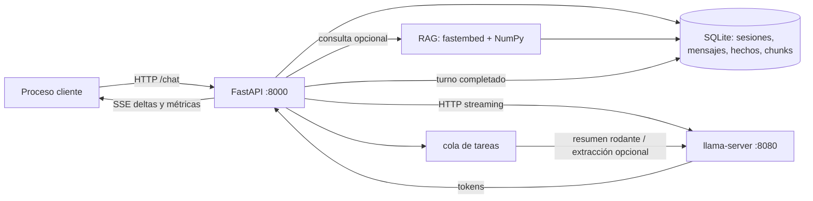
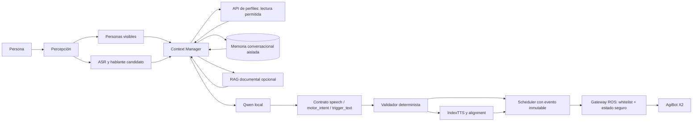

# Auditoría de `feat/llm-local-rag-memory`

**Fecha:** 21 de octubre de 2026
**Branch revisada:** `feat/llm-local-rag-memory` (`750bb3f`)

## Resumen ejecutivo

La branch añade un servicio conversacional local: API FastAPI, `llama.cpp`, memoria de sesión y recuperación documental ligera. No implementa un sistema HRI integrado: no conecta percepción facial, ASR, IndexTTS, alineación temporal ni ejecución motora con las respuestas del LLM.

**Recomendación:** reutilizar el servicio de inferencia local y, tras validarlo, su recuperación documental como piezas opcionales. Para AgiBot, construir un **Context Manager independiente** que consulte la base institucional mediante una interfaz de solo lectura y mantenga la memoria de conversación con ámbitos de identidad explícitos. La memoria actual no debe gestionar identidades: sus hechos son globales y no están asociados a una persona.

## A. Arquitectura original

El recorrido de `POST /chat` es:

La API reúne el prompt y el historial, recupera chunks y hechos si el RAG está disponible, y agrega ese contexto al último mensaje del usuario. Luego llama a `llama-server` por HTTP y envía la respuesta en SSE. Al terminar, guarda el mensaje original y la respuesta; un hilo de fondo puede resumir el historial o extraer hechos. La implementación está en [`main.py`](../llm/api/app/main.py#L227), [`prompts.py`](../llm/api/app/prompts.py#L51) y [`llm_client.py`](../llm/api/app/llm_client.py#L22).

| Componente | Responsabilidad e interfaces |
|---|---|
| `app.main:create_app` | FastAPI; prepara turnos y ofrece `/chat`, proxy OpenAI, sesiones, hechos, RAG, salud y métricas. |
| `Store` | SQLite para sesiones, mensajes, resúmenes, hechos y chunks; serializa acceso a una conexión compartida. |
| `RagIndex` / `Embedder` | Ingesta, fragmentación, embeddings y búsqueda coseno en memoria. |
| `LocalLLM` | Cliente HTTP a `llama-server`, con streaming SSE, keep-alive, warmup y generación no streaming para tareas de fondo. |
| `run.sh` y `entrypoint.sh` | Inician y supervisan `llama-server` y Uvicorn dentro del mismo contenedor. |
| CLI | `chat.py`, `probe.py`, `ingest.py` y scripts de descarga de modelos. |
| Tests | Tres módulos; usan LLM y embedder falsos para probar API, memoria y fragmentación. |

El código es principalmente Python, con scripts Bash, configuración Compose YAML, Dockerfile y un descargador PowerShell. Las dependencias declaradas para la API son FastAPI, Uvicorn, HTTPX, NumPy y fastembed, en rangos de versión, no versiones exactas ([`requirements.txt`](../llm/api/requirements.txt#L1)). Los puntos de entrada y los puertos están en [`docker-compose.yml`](../llm/docker-compose.yml#L17) y [`run.sh`](../llm/server/run.sh#L21).

La API también incluye un proxy OpenAI crudo. Ese camino no utiliza memoria ni RAG ([`main.py`](../llm/api/app/main.py#L313)). No encontré conexión de esta API a ROS 2, percepción, ASR, IndexTTS, un alineador ni un scheduler motor.

## B. Diagnóstico de RAG

**Lo que implementa:** ingesta recursiva de `.md` y `.txt` de hasta 2 MB; fragmenta por párrafos, con fragmentos de 600 caracteres y solape de 120 por defecto. Usa `minishlab/potion-multilingual-128M` mediante fastembed/ONNX, normaliza vectores y calcula similitud coseno con NumPy. Guarda los vectores como BLOB en SQLite y busca por fuerza bruta, devolviendo hasta tres resultados sobre el umbral configurado. Véanse [`rag.py`](../llm/api/app/rag.py#L124), [`rag.py`](../llm/api/app/rag.py#L174) y [`config.py`](../llm/api/app/config.py#L46).

La ingesta automática apunta a `../docs`, montado como `/corpus`; el índice se llena al inicio sólo si no contiene chunks. También hay endpoints de ingesta de directorios y texto. Si el embedder no está listo, el chat puede continuar sin contexto; si la búsqueda devuelve cero resultados, el mensaje llega sin envoltorio RAG. No hay búsqueda lexical, híbrida ni reranking. El contexto se presenta al modelo con etiquetas de documento, pero no se aplica una política verificable de confianza, contradicción o resistencia a instrucciones maliciosas incluidas en los documentos.

**Límites relevantes:** el hash hace idempotente reingestar el mismo chunk con la misma fuente e índice, pero no hay un manifiesto de documentos que retire chunks viejos cuando un archivo cambia o se elimina. Tampoco se guardan junto a cada vector la revisión exacta del corpus o la versión del modelo de embeddings. Cambiar modelo o dimensiones sin reconstruir el índice puede mezclar vectores incompatibles. La búsqueda y la latencia de recuperación no se miden por separado.

Hay tres funciones distintas:

- **Recuperación estructurada:** la branch no tiene tablas de personas, rangos, plantillas biométricas ni consultas institucionales.
- **RAG documental:** chunks de texto buscados semánticamente.
- **Memoria conversacional:** mensajes y resúmenes asociados a `session_id`.

Aunque residen en la misma SQLite, la memoria conversacional no es el RAG documental. La tabla `facts` tampoco sustituye una consulta estructurada: contiene hechos en texto, opcionalmente vectorizados.

**Para X2:** conservar RAG sólo para documentación institucional o técnica cuando una evaluación muestre que mejora las respuestas. Para rango y atributos de una persona, consultar la fuente estructurada con una interfaz de lectura parametrizada. Si el corpus es pequeño, incluir SQLite FTS5 en la comparación antes de depender de embeddings. No usar RAG para decidir quién está hablando.

## C. Diagnóstico de memoria y SQLite

El esquema real tiene cuatro tablas: `sessions`, `messages`, `facts` y `chunks`. `messages.session_id` tiene un índice, pero no se declaran claves foráneas ni relaciones con personas. `facts` contiene `content UNIQUE`, embedding y timestamp; no tiene `session_id`, sujeto, procedencia, confianza ni expiración. La conexión usa WAL, `check_same_thread=False` y un `RLock` ([`memory.py`](../llm/api/app/memory.py#L19), [`memory.py`](../llm/api/app/memory.py#L53)).

La memoria de conversación conserva el historial y, tras superar 24 **mensajes**, resume los antiguos y deja 12 activos. El resumen de hasta 200 palabras se añade al system prompt; los mensajes resumidos siguen almacenados y sólo dejan de formar parte del historial activo. No hay borrado por antigüedad. La política está en [`main.py`](../llm/api/app/main.py#L120) y la configuración por defecto en [`config.py`](../llm/api/app/config.py#L37).

Si “diez intervenciones” significa diez intercambios usuario/asistente, serían normalmente 20 mensajes: no se activa el resumen por defecto. Tras reiniciar el proceso, el historial se recupera si el cliente vuelve a usar el mismo `session_id`; la SQLite está en el volumen persistente `./data`. El caché KV del LLM sí se pierde al reiniciar el contenedor, por lo que el primer turno vuelve a procesar el historial. Una sesión nueva no hereda el historial anterior.

La extracción de hechos está desactivada por defecto (`FACT_EXTRACT=false`). Si se activa, hace una llamada adicional al LLM por turno en segundo plano. El hecho se guarda globalmente: `sid` sólo se usa en el log, no para asociar el dato con esa sesión o persona ([`main.py`](../llm/api/app/main.py#L147)). Además, el `session_id` predeterminado es `"default"` ([`main.py`](../llm/api/app/main.py#L178)). Para HRI, esos valores no aíslan interlocutores. La búsqueda global de hechos podría mezclar usuarios; el reconocimiento facial por sí solo tampoco permite afirmar quién está hablando.

El `RLock` serializa operaciones individuales sobre la conexión, pero no hay transacción o bloqueo por sesión que abarque armado de contexto, inferencia y escritura. Inferencia: solicitudes simultáneas a una misma sesión pueden construir prompts con el mismo historial y persistir respuestas en un orden distinto al conversacional. La cola de tareas de fondo tiene límite 64 y descarta tareas cuando está llena.

**Integración recomendada:** no compartir el archivo SQLite institucional con este `Store`. Mantener una interfaz de consulta institucional de sólo lectura que devuelva una lista permitida de atributos ya saneados; el Context Manager conserva aparte la memoria conversacional, segmentada por sesión y sujeto pseudónimo cuando la atribución tenga evidencia suficiente. Los eventos de percepción pueden actualizar la hipótesis de interlocutor activo; la consulta de atributos debe seguir leyendo la fuente institucional autorizada. No pasar embeddings faciales al LLM.

## D. Diagnóstico del LLM y contenedores

El código configura y descarga **Qwen3-4B Q4_K_M en GGUF**, no Qwen3.5-4B. El script construye la URL del repositorio `Qwen/Qwen3-4B-GGUF` con `resolve/main`; no fija commit, revisión ni hash. El directorio `llm/models` sólo contiene `.gitkeep`, así que aquí no hay un GGUF que permita comprobar su metadata o checksum ([`download-model.sh`](../llm/scripts/download-model.sh#L12), [`docker-compose.yml`](../llm/docker-compose.yml#L35)).

Por tanto, **no se puede confirmar la revisión exacta de Qwen3 ni comparar justamente Qwen3.5-4B con este artefacto** desde el checkout. Tampoco hay configuración de Qwen3.5 en esta branch. Habría que fijar la revisión inmutable y registrar el hash del archivo y del runtime antes del experimento.

El motor es `llama.cpp` (`llama-server`) y la API habla con él mediante la interfaz compatible con OpenAI. La configuración usa `max_tokens=512`, temperatura `0.7`, `enable_thinking=false`, cache KV `q8_0` y un slot paralelo por defecto. Los perfiles establecen 16K de contexto para Jetson Orin NX y 32K para x86 con CUDA; el perfil CPU usa 4K si no se proporciona `.env`. El entrypoint detecta qué flags están disponibles en la imagen y puede activar Flash Attention, `--cache-reuse` y decodificación especulativa ([`.env.example`](../llm/.env.example#L15), [`entrypoint.sh`](../llm/server/entrypoint.sh#L42)).

Hay un contenedor y dentro corren **dos procesos**: `llama-server` en 8080 y FastAPI/Uvicorn en 8000. El RAG vive en la API. SQLite se abre dentro del contenedor en `/data/agent.db`, pero los bytes persisten en el host mediante el volumen `./data:/data`; los modelos están en `./models` y los documentos se montan de sólo lectura. Si el contenedor reinicia, ambos procesos vuelven a arrancar y los datos del volumen permanecen ([`docker-compose.yml`](../llm/docker-compose.yml#L27), [`Dockerfile`](../llm/server/Dockerfile#L35)).

Los perfiles CUDA habilitan GPU con mecanismos distintos para Jetson y x86. Seguirán compartiendo CPU, GPU y memoria unificada con los demás procesos del robot. El tamaño del GGUF no es la RAM total: la README estima alrededor de 2,5 GB para los pesos y 1,2 GB de KV para 16K (2,4 GB para 32K), antes de buffers, runtime y servicios adicionales. También se descarga el modelo ONNX de embeddings, indicado como aproximadamente 500 MB. Son cifras documentadas, no mediciones de esta auditoría. La propia README presenta 100–300 ms de TTFT y 35–40 tokens/s en Orin NX como rendimiento esperado, no como resultados verificados ([`README.md`](../llm/README.md#L27), [`README.md`](../llm/README.md#L89)).

**Despliegue y privacidad:** los perfiles Docker dan una receta reproducible y aislan dependencias; ejecutar directamente sobre Linux eliminaría la capa de contenedor y podría simplificar acceso a GPU/ROS, pero requeriría administrar versiones del sistema. No medí diferencias de latencia. El contenedor actual no contiene ROS ni un adaptador ROS. Además, Compose publica ambos puertos sin limitar la dirección del host, y los endpoints no tienen autenticación: no trataría la afirmación “100 % local” como garantía de aislamiento de red para un robot conectado a una LAN. El primer arranque requiere descargar el modelo de embeddings si no existe en caché.

## E. Compatibilidad con AgiBot X2

En este checkout sí existen interfaces de audio/TTS del gemelo y un catálogo de gestos. El gemelo expone `PlayTts` mediante espeak-ng y publica audio/VAD; ese VAD entrega audio y estados, no texto transcrito ([`ros_audio.py`](../src/x2_ultra/twin/ros_audio.py#L158), [`ros_audio.py`](../src/x2_ultra/twin/ros_audio.py#L214)). El reproductor real de gestos es una UI operada por una persona, aplica comprobaciones del estado del robot y llama servicios de movimientos predefinidos; no recibe intenciones del LLM ([`motions.py`](../src/x2_ultra/real/motions.py#L107), [`motions.py`](../src/x2_ultra/real/motions.py#L202)).

No encontré en el repo código de UniFace, BYTETracker, ASR, IndexTTS, alineador, scheduler conversacional ni campos `speech`, `motor_intent` o `trigger_text`. Esto describe sólo el checkout inspeccionado; tomo la ejecución previa de `POINT_RIGHT` en MuJoCo como contexto que aportaste, no como algo demostrado por este repo.

| Clasificación | Componentes |
|---|---|
| **Reutilizables con pocos cambios** | Cliente local `LocalLLM`, streaming, proxy de compatibilidad y endpoint de métricas como base del servicio de inferencia. |
| **Reutilizables con modificaciones** | `RagIndex` y `chunk_text` para documentos; historial y resumen de `Store`, una vez añadidos aislamiento de sujeto/sesión, retención y concurrencia por sesión. |
| **Reemplazar para HRI** | La tabla y recuperación global de `facts` como memoria personal; sustituirla por Context Manager y memoria acotada por sujeto con procedencia y política de consentimiento. |
| **Fuera del MVP inicial** | Extracción automática de hechos (añade inferencias y no tiene ámbito de identidad), decodificación especulativa y corpus documental completo sin selección. |
| **Pendiente de validar** | Calidad de embeddings en el corpus real, rendimiento en el Orin NX, revisión del modelo, streaming estructurado, concurrencia, privacidad, integración IndexTTS/alignment y selección segura de gestos. |

## F. Arquitectura objetivo

Mantendría separados el hecho de que alguien sea visible y la hipótesis de que sea quien habló. El Context Manager sólo recibe identificadores o atributos sanitizados, con confianza y procedencia; si el hablante activo no está suficientemente identificado, no incorpora personalización específica de esa persona.

El LLM debe producir el contrato semántico-motor existente, sin otro modelo que vuelva a interpretar la semántica. Añadiría versión de esquema y `turn_id`/`utterance_id`; validaría campos, enums permitidos y que el texto de anclaje corresponda al discurso. La ejecución motora quedaría fuera del ciclo de generación: tras validar, el scheduler guarda un evento inmutable ligado al audio y a la respuesta concreta. Una respuesta posterior no modifica un gesto ya comprometido. El gateway motor aplica la whitelist y las comprobaciones de estado del robot; el LLM nunca emite comandos directos.

Para la base institucional, recomiendo **bases separadas comunicadas por una interfaz de lectura**. Compartir un archivo simplificaría el cableado, pero mezcla dominios y permisos y no resuelve la atribución del hablante. SQLite estructurado o FTS5 puede bastar para atributos y nombres de políticas; embeddings quedan para documentación en lenguaje libre. Los eventos son útiles para actualizar el contexto activo, pero no sustituyen la fuente institucional autorizada.

## G. Plan de modificación incremental

1. **Fijar el baseline.** Registrar checkpoint y SHA-256 de modelos, runtime/container, parámetros y hardware. Sin descargar nada hasta autorizarlo y saber dónde están los artefactos.
2. **Definir la interfaz del Context Manager.** Entrada: turno, transcripción, personas visibles y candidato a hablante con confianza/procedencia. Salida: contexto sanitizado para el LLM. La base institucional queda de sólo lectura y no expone embeddings.
3. **Aislar memoria.** Mantener una SQLite distinta o servicio separado para conversación; claves explícitas de sesión/sujeto, procedencia, correcciones, consentimiento y expiración. Desactivar `FACT_EXTRACT` hasta que exista política de atribución.
4. **Añadir contrato estructurado.** Extender el modelo de petición/respuesta y el prompt en `main.py` y `prompts.py`; validar el contrato sin inferencia semántica adicional. Mantener `/chat` para uso general.
5. **Endurecer RAG documental.** Corpus curado, revisión/versionado de documentos y embeddings, eliminación de chunks obsoletos, tests contra instrucciones incrustadas y comparación con FTS5.
6. **Integrar voz y movimiento.** Adaptador ROS separado del contenedor LLM. Empezar en gemelo/mock; conectar texto a TTS y el contrato validado al scheduler. Los movimientos reales requieren las comprobaciones de estado existentes, no sólo una etiqueta producida por Qwen.
7. **Instrumentar y comparar.** Medir cada etapa con un ID de turno común: contexto, consultas, inferencia, TTS, alignment y scheduler. Añadir tests de aislamiento entre identidades y requests simultáneas antes de usarlo con datos reales.

## H. Evaluación experimental y validación

**Validación realizada en este entorno:** AST parse de 13 archivos Python sin errores; `bash -n` de scripts de descarga y arranque pasó. Hice un smoke aislado en `/tmp` que comprobó persistencia SQLite tras reabrir la base, resumen, hechos y fragmentación. El worktree sigue limpio. No descargué modelos ni creé contenedores.

No pude ejecutar los 23 tests definidos en `llm/tests`: falta `pytest` y tampoco está instalada FastAPI en el entorno. No instalé dependencias. Esos tests usan LLM y embedder falsos, así que incluso al ejecutarlos no demostrarían rendimiento o calidad de recuperación con el modelo real. No se midieron TTFT, tokens/s, memoria, GPU, consumo energético, recuperación semántica real ni calidad HRI.

| Experimento | Diseño y métricas | Resultado actual |
|---|---|---|
| **A. Coherencia y persistencia** | Diálogos de diez intercambios con referencias, correcciones, cambio de tema, identidad alternada y reinicio; medir referencias correctas, contradicciones, invenciones y contaminación entre sujetos. Tras reiniciar, reutilizar el mismo ID y luego uno nuevo. | Pendiente con LLM real. El código indica que diez intercambios normalmente no disparan el resumen (20 de 24 mensajes); la persistencia de SQLite se verificó sólo con smoke básico. |
| **B. Coherencia motora** | Casos de señalar, bienvenida, sin gesto, negación, ambigüedad espacial y referencias previas. Medir validez de esquema, precisión/recall de intención, falsos positivos, omisiones y error temporal del anclaje. Separar clasificación del LLM, alineación y scheduler con logs. | Pendiente. No existe pipeline integrado en este repo. Primero ejecutar con scheduler simulado. |
| **C. Naturalidad** | Evaluación humana ciega y aleatorizada del mismo contenido; puntuar naturalidad textual, repetición y personalización; puntuar por separado prosodia y adecuación gestual. | Pendiente; no hay grabaciones ni pipeline IndexTTS aquí. |
| **D. SQLite/RAG** | Comparar A: historial corto; B: consulta estructurada; C: estructurada + docs RAG; D: servicio original. Mismo modelo, prompt, corpus, datos disponibles y presupuesto de contexto. Medir exactitud factual, alucinaciones, abstención, precisión/recall de recuperación y naturalidad. | Pendiente. La branch prueba flujo con embedder falso, no exactitud semántica real. |
| **E. Recursos** | Misma carga en el dispositivo: latencia fin a fin p50/p95 y por etapa, TTFT, tokens/s, RSS, VRAM/memoria unificada, CPU/GPU, energía y temperatura; cold start y caliente, recuperación con y sin contexto. | Pendiente; las cifras de README son estimaciones. |
| **F. Modelos** | Sólo después de fijar revisiones exactas de Qwen3.5-4B y Qwen3-4B Q4_K_M; controlar prompt, generación, contexto, runtime y datos recuperados. Analizar modelo y runtime como factores separados. | Pendiente: esta branch sólo configura Qwen3-4B `Q4_K_M` descargado desde `main`; no hay artefacto local ni revisión fijada. |

Como criterios iniciales —**propuestos, no medidos**— exigiría que la recuperación estructurada/documental aumente la exactitud factual sin aumentar afirmaciones no sustentadas; que las salidas del contrato sean válidas en al menos el 99 % de los casos y que los falsos positivos motores se mantengan por debajo del 1 % en el conjunto de prueba. Para naturalidad, usaría una prueba de no inferioridad con margen acordado antes del experimento. El límite temporal del alignment debe derivarse de la tolerancia real del scheduler, aún no disponible en este checkout.

## I. Recomendación técnica

**No adoptaría esta branch completa como gestor de memoria del AgiBot. Reutilizaría partes y desarrollaría un Context Manager independiente.**

El servicio resuelve bien una parte concreta: inferencia local con una API HTTP, streaming, resumen de sesión y un RAG documental ligero. Pero su `facts` es global, no identifica personas, no conserva procedencia y puede mezclar hechos de sesiones; tampoco sabe quién está hablando ni produce el contrato motor. Eso lo hace inadecuado como dueño de la memoria institucional o como árbitro de identidad.

Mantendría separadas tres responsabilidades: el servicio de inferencia genera lenguaje y el contrato; el Context Manager reúne historial, hipótesis de interlocutor y atributos institucionales permitidos; un validador y gateway deterministas deciden qué acciones motoras pueden programarse y ejecutarse. RAG documental se incorpora sólo si el experimento D demuestra mejora frente a SQLite/FTS5 y sin perjudicar naturalidad, privacidad o latencia.

Las piezas que más sentido tiene prototipar primero son `LocalLLM` y el RAG documental, junto con una nueva interfaz de contexto. Antes de comparar modelos o afirmar recursos del X2, falta fijar los artefactos exactos y ejecutar la prueba en el hardware objetivo.
