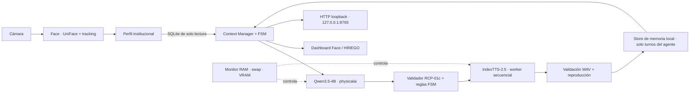

# HRIEGO — Integración autónoma de recepción

**Estado:** implementación en la rama `Facial,-LLM-and-Gesture-integration`
**Entorno de Qwen:** `physicalai`
**Fecha de validación:** 2026-10-21

## Propósito

HRIEGO integra la percepción facial de `Face`, el Context Manager y la memoria local de `llm`, Qwen3.5-4B y la voz IndexTTS-2.5 de Laplace para ejecutar una interacción de recepción en español. El alcance habilitado cubre saludo, orientación a un destino autorizado y despedida. Las intenciones motoras solo se registran para evaluación; esta integración no conecta ni ejecuta motores.

## Arquitectura



El controlador ejecuta una sola carga de modelo a la vez: Qwen se descarga antes de cargar IndexTTS. La FSM solo avanza cuando la respuesta pasa el contrato, el WAV es válido y la reproducción termina correctamente. Luego guarda el texto hablado del agente en la sesión y pasa al estado siguiente.

## Interacción y políticas

1. Face debe confirmar exactamente una identidad activa con su servicio de perfiles institucionales. Una cara desconocida, varios rostros, perfil incompleto o cámara desconectada no inicia una interacción.
2. La visita se consume al comenzar. La detección confirmada de ausencia durante 3 segundos permite rearmarla.
3. La FSM recorre `GREETING → GUIDANCE → FAREWELL → IDLE`. Una cancelación, respuesta inválida, problema de audio o presión de recursos aborta la ejecución.
4. La identidad estable, la política del estado y la política lingüística del rango se ensamblan en un único mensaje `system`, compatible con la plantilla instalada de Qwen3.5. El perfil está limitado a una lista permitida; no se entregan imágenes, embeddings, landmarks ni plantillas faciales.
5. La respuesta debe satisfacer el esquema RCP-01c original de Laplace y las restricciones adicionales por estado. Orientación admite únicamente `POINT_RIGHT`, con `X2_base_local`, vector `[0.0, -1.0, 0.0]`, frase literal de activación y `event_id` igual al ID del turno. El acto comunicativo debe pertenecer a la política del estado.
6. Los rangos `VIP`, `REGULAR`, `GUEST`, `STAFF` y `EXTERNAL` cambian solo el tono y el tratamiento lingüístico. No conceden acceso, privilegios ni permisos.
7. La identidad institucional se abre en modo de solo lectura. La memoria de conversación es una base separada y reutiliza `llm.api.app.memory.Store`; conserva únicamente intervenciones del agente que ya se reprodujeron, separadas por `session_id`. No se añaden hechos a la memoria semántica. RAG está deshabilitado por defecto.

## Componentes y configuración

| Área | Implementación |
|---|---|
| Percepción | Adaptador sobre `Face/live/live_recognizer.py` y `ProfileService`, webcam 0, 640×480 en la validación. |
| Context Manager | `hriego/context.py`, `coordinator.py`, `fsm.py`; identidad, políticas y escenario versionados en `hriego/config/`. |
| LLM | Qwen/Qwen3.5-4B local, revisión `851bf6e806efd8d0a36b00ddf55e13ccb7b8cd0a`, cargado con el intérprete `/home/luis/anaconda3/envs/physicalai/bin/python`. |
| Memoria | `llm/data/hriego_conversations.sqlite3`, separada por sesión y protegida con permisos locales restrictivos. |
| Voz | IndexTeam/IndexTTS-2.5 local, revisión `c39ce5ba981572cb187443877ff559dfb246ce63`; usa la voz autorizada configurada en Laplace. Salida mono WAV a 22.050 Hz. |
| Auditoría | `hriego/data/hriego_experiment.sqlite3`, con tablas de ejecuciones y eventos; no almacena imágenes ni embeddings. |
| Datos de audio | `hriego/data/audio/<visit_id>/<turn_id>.wav`, con permisos `0600`. |
| API | Escucha solo en `127.0.0.1:8765`; no modifica la ruta `/chat` existente. |
| Interfaz | Dashboard dividido: panel de Face a la izquierda y perfil, FSM, política, contrato, audio y recursos a la derecha. |

El launcher `scripts/run_hriego.sh` selecciona Face, Qwen y el entorno `.venv-index` de Laplace, fija ejecución offline y agrega el código UniFace local al `PYTHONPATH`. Se puede cambiar cada intérprete con `HRIEGO_FACE_PYTHON`, `HRIEGO_QWEN_PYTHON` o `HRIEGO_INDEX_PYTHON`.

**Distinción de integración:** HRIEGO reutiliza `llm.api.app.memory.Store` para el historial local, pero no llama al motor inferencial propio de `llm` (`LocalLLM`/`llama-server`) ni a su endpoint `/chat`. El worker de HRIEGO carga Qwen3.5-4B directamente con Transformers desde el entorno `physicalai`. El servicio existente de `llm` usa `llama-server` y su configuración de modelo Qwen3-4B Q4_K_M. Por eso, la memoria del proyecto sí se reutiliza; su servicio de inferencia y su streaming SSE no forman parte del camino actual de HRIEGO.

## API local

| Ruta | Función |
|---|---|
| `GET /health` | Salud del servicio. |
| `GET /ready` | Disponibilidad de cámara. |
| `GET /state` | Estado de FSM, ejecución, métricas y recursos. |
| `GET /events` | Eventos en formato SSE. |
| `POST /hriego` | Solicita una interacción; el cuerpo solo admite `scenario_id`. La identidad siempre viene de la cámara. |
| `POST /cancel` | Cancela el ciclo activo. |

Escenario configurado: `reception_lab_right`, escena `E3`, destino “laboratorio”, a la derecha local del agente. El servicio rechaza campos adicionales en `/hriego` y no acepta que el llamador suplante la identidad.

## Entornos y recursos medidos

Preflight ejecutado con acceso a cámara/GPU:

- **GPU:** NVIDIA GeForce RTX 5070 Ti Laptop GPU, 12.82 GB VRAM.
- **RAM física:** 24.31 GB.
- **Qwen / physicalai:** Python 3.12.14, PyTorch 2.11.0+cu128, Transformers 5.17.0, CUDA 12.8.
- **IndexTTS:** Python 3.11.16, PyTorch 2.8.0+cu128, Transformers 4.52.1, paquete `indextts` 2.0.0.
- **Registro institucional:** `integrity_check=ok`, sin errores de claves foráneas, cinco identidades previstas y cinco rangos; conexión de solo lectura.
- **VRAM conjunta:** Qwen e IndexTTS no caben con la reserva configurada; se impone ejecución secuencial.

Durante las inferencias reales de Qwen se midió aproximadamente 9.45–9.49 GB de VRAM asignada y 9.42–9.99 GB de pico RSS del worker. Cada respuesta observada usó 90–129 tokens y tardó aproximadamente 4.7–6.4 s en generación, además de 7–8.4 s de carga del modelo.

IndexTTS cargó correctamente en dos turnos: 25–26 s para cargar y 6.4–6.8 s para sintetizar. Produjo WAV mono de 22.050 Hz, de 3.59 y 4.31 s, que el reproductor terminó correctamente. Para reducir el pico se desactiva QwenEmotion (no se usa con el vector emocional fijo configurado) y el worker HRIEGO carga el checkpoint GPT con mmap y asignación directa de pesos. No se modificó el código de Laplace.

## Ejecución y validaciones

Desde la raíz del repositorio:

```bash
./scripts/run_hriego.sh
./scripts/run_hriego.sh --check-only
PYTHONPATH="$PWD/Face/thirdparty/uniface:$PWD/Face:$PWD:/home/luis/GitHub/Laplace/voice" \
  /home/luis/anaconda3/envs/physicalai/bin/python -m unittest discover -s hriego/tests -v
```

La suite reportó **13 pruebas aprobadas** en el entorno `physicalai`, cubriendo ensamblado de contexto, ausencia de datos biométricos en el prompt, política por rango, contrato y ancla motora, FSM, rearmado de visita, memoria aislada, diario de auditoría, checkpoint mmap, guardián de swap y limpieza de workers.

El preflight completo se aprobó en la sesión con permisos de dispositivo. El intento desde sandbox restringido no pudo abrir `/dev/video0`; con acceso local se verificaron cámara, GPU, entornos y SQLite.

### Resultado de la prueba con cámara y audio

La cámara confirmó un único perfil institucional activo. En la ejecución principal se reprodujeron el saludo y la orientación; ambas respuestas de Qwen pasaron el contrato que estaba vigente en esa ejecución. La orientación quedó registrada como `POINT_RIGHT`, con frase literal “a mi derecha”; **no se envió ninguna orden a motores**. Qwen generó también una despedida válida, pero IndexTTS fue cancelado al cargarla.

Se probó una segunda visita tras la ausencia confirmada. Qwen generó el saludo, pero el worker de IndexTTS volvió a ser cancelado antes de producir audio. En ambas cargas fallidas coincidieron swap del sistema prácticamente agotada (0–217 KiB libres de 2 GiB) y presión de RAM; el guardián detuvo el worker antes de que siguiera aumentando el consumo. La app se cerró limpiamente. Al cierre quedaron aproximadamente 9.94 GB de RAM disponibles y 11.77 GB de VRAM libres; la swap seguía prácticamente llena.

**Por tanto, la prueba de punta a punta no completó `FAREWELL → IDLE` con reproducción de despedida.** El límite de tokens que impidió parsear una orientación en un intento anterior ya se corrigió: ahora se solicitan 320 tokens y JSON compacto; las respuestas posteriores quedaron por debajo del límite. No se relajó el guardián de RAM/swap para forzar otra carga.

Después de la ejecución en vivo se endureció el validador para rechazar actos comunicativos de otros estados y exigir que `event_id` coincida con el ID del turno. Esos casos pasan las pruebas unitarias; el validador endurecido aún requiere una nueva validación en vivo con margen de memoria suficiente.

## Riesgos y siguientes pasos

- Liberar swap/RAM del sistema de forma controlada antes de repetir la validación completa. No se cerraron otras aplicaciones ni se alteró la configuración de swap.
- Repetir un ciclo completo y una segunda visita con margen de memoria suficiente; confirmar los tres WAV y las transiciones hasta `IDLE`.
- La UI mostró avisos de fuentes faltantes de Qt/OpenCV, pero la ventana y el flujo de percepción funcionaron. No se instalaron dependencias del sistema para esta prueba.
- El catálogo solo contiene el escenario experimental de orientación a la derecha. Añadir otro destino requiere su validación institucional y motora independiente; no se infiere ni se activa movimiento físico desde HRIEGO.
